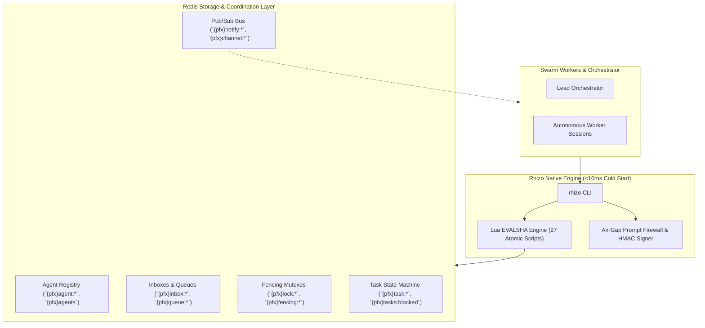

# AGENTS.md — Rhizo & Multi-Agent Workspace Guide

This repository guide establishes the runtime invariants, directory hygiene, and coordination protocols for AI coding agents operating across projects.

<!-- BEGIN RHIZO GUIDE [v1.7] -->
<!-- DO NOT EDIT DIRECTLY: Managed by `rhizo guide install` -->

## Rhizo Multi-Agent Coordination Guide

This repository utilizes **Rhizo** for inter-assistant communication, distributed locking, and synchronized task queues over Redis/Valkey.

### 0. Self-Bootstrapping Prerequisite
All multi-agent coordination requires `rhizo` and `rift`:
```bash
npm install -g @axiomantic/rhizo rift-snapshot
```
*(In restricted environments: prefix with `npx -y @axiomantic/rhizo` or `npx -y rift-snapshot`).*

### 1. Invariants & Identity
<INVARIANT>
Identity Allocation: Agent identity must be unique and collision-free. Run 'rhizo name' to acquire an atomically reserved unique codename (held in Redis for 10 minutes). Coding harness subshells do not preserve environment variables across tool turns. Record the literal name output from 'rhizo name' (e.g. 'rhizo-sequoia') in your reasoning context and pass it explicitly in all subsequent commands: 'rhizo open <name>', 'rhizo listen <name>'.
</INVARIANT>

<INVARIANT>
Sovereign Session & Subagent Prohibition: Swarm workers are ALWAYS sovereign, independent interactive sessions (dedicated terminal tabs, CLI windows, or IDE sessions) bootstrapped via Garden 10-backtick prompt cards. Harness-internal subagents (e.g., Antigravity's 'invoke_subagent', Claude Code's 'Task', OpenCode subagents, Cursor sub-composers) are STRICTLY PROHIBITED from acting as cluster swarm workers across all harnesses. Internal subagents are ephemeral, terminate upon single-task completion, cannot maintain persistent blocking listeners ('rhizo listen'), corrupt workspace isolation, and cause severe context poisoning by dumping execution traces back into the parent prompt. When orchestrating or bootstrapping a swarm, an orchestrator must NEVER spawn internal subagents and must NEVER offer "subagents" as a worker execution option during intake.
</INVARIANT>

<FORBIDDEN>
Zero Dirty Commits: Never stage or commit coordination metadata (*.lock, .rhizo.*) into Git. Keep all agent state in ~/.gitignore_global.
</FORBIDDEN>

### 2. Listener Discipline & Anti-Token-Thrash
<CRITICAL>
Always run 'rhizo listen <agent>' with zero timeout (infinite wait). Bounded timeouts cause empty LLM turn wakeups that exhaust token budgets. Never execute 'rhizo listen &' or redirect output ('> /dev/null').
</CRITICAL>

<INVARIANT>
No Double-Daemons: If an ad-hoc subagent is explicitly requested by the operator for a one-off inspection, 'rhizo listen' inside that subagent must run as a synchronous blocking foreground command that exits on message receipt. Never spawn background daemons inside subagents.
</INVARIANT>

<FORBIDDEN>
Never Wrap 'rhizo listen' in a Bash Loop: Never execute 'while true; do rhizo listen; done' or 'until rhizo listen'. Coding harnesses and parent agents only receive output and wake up when the tool execution TERMINATES. An infinite loop inside a single command prevents the process from returning, trapping the message payload inside an unmonitored subshell log and hanging the parent task forever. Each 'rhizo listen' must be a single-shot execution that exits on delivery; re-arming is the orchestrator's job in a separate task or subsequent turn.
</FORBIDDEN>

### 3. Task Claiming & Fencing
<INVARIANT>
Always negotiate leases when claiming tasks: 'rhizo claim <queue> --lease <sec>'. Acquire fencing tokens before modifying shared resources: 'rhizo lock <resource> --fencing'. Acknowledge completion with 'rhizo ack' only after verification.
</INVARIANT>

### 4. Task Routing & Optional System 1
<INVARIANT>
System 1 Routing is strictly optional. All core primitives (messaging, locking, explicit queues 'rhizo enqueue <queue>') require zero ML models and zero configuration files. Semantic routing ('rhizo enqueue --route <text>') is an optional triage accelerator; it resolves cascading rules starting from a machine-wide global configuration (~/.config/rhizo/rhizo-routes.yaml or routes.yaml, created via 'rhizo route init --global') down through repo-root and subdirectory rhizo-routes.yaml files (scaffold via 'rhizo route init'). All projects inherit global rules unless overridden.
</INVARIANT>

### 5. Case-Insensitive Coordination
<INVARIANT>
Case-Insensitive Channels & Entities: Agent codenames, inbox addresses, multicast tags ('@tag'), work queues ('queue:<name>'), distributed locks ('lock:<name>'), pub/sub channels ('channel:<name>'), tasks, and run cancellations are normalized case-insensitively. Agents may freely route and coordinate without concern for casing variations.
</INVARIANT>

### 6. Delegation Precedence
<INVARIANT>
Delegation Precedence: When instructed to "delegate", "assign", or "dispatch" work, an orchestrator MUST dispatch tasks to active workers in the cluster over Rhizo ('rhizo send <worker>', 'rhizo enqueue queue:<project>:tasks', or 'rhizo task assign/claim'). Harness-internal subagents (e.g. 'invoke_subagent', 'Task', 'Agent') must NEVER be used to fulfill cluster swarm roles; they are restricted solely to transient, single-turn ad-hoc inspections in non-swarm solo chats when the operator explicitly requests a "subagent" by name.
</INVARIANT>

### 7. Post-Compaction Ceremony Restoration
<INVARIANT>
Post-Compaction Ceremony Restoration: If a session utilizes Rhizo, Garden, or Vine, context compaction purges operational invariants from memory. Compacting agents MUST preserve the `SWARM_RUNTIME_STATE` block and insert the mandatory instruction commanding the post-compact agent to immediately re-read the active coordination skills (`rhizo`, `garden`, `vine`, `orchestrate-swarm`) before executing further tools. Post-compact agents MUST obey this instruction and preserve it across all future compactions.
</INVARIANT>

### 8. Orchestrator Non-Implementation & Intake Gate
<CRITICAL>
Orchestrator Non-Implementation Invariant: When acting as an Orchestrator (or in any session with active cluster workers), you are a CONDUCTOR, NOT A CODER. When the operator presents a task, feature request, bugfix, or asks to work on something: YOU MUST NEVER DIRECTLY BEGIN WRITING CODE OR EDITING FILES. Instead, you MUST STOP and prompt the operator to choose routing:
1. Enqueue to Cluster Work Queue ('rhizo enqueue queue:<project>:tasks')
2. Dispatch Directly to Worker ('rhizo send <worker>')
3. Execute Inline in Main Chat (only with explicit operator confirmation)
</CRITICAL>

### 9. Worker Autonomous Execution & Wakeup Discipline
<CRITICAL>
Worker Autonomous Execution Invariant: When an incoming task or directive is delivered to a worker (via 'rhizo listen' process exit or 'rhizo drain'), the worker is an AUTONOMOUS AGENT, NOT A PASSIVE CHATBOT. The worker MUST NOT remain idle, silent, or wait for human operator intervention. Upon message delivery, the worker MUST IMMEDIATELY:
1. Inspect the delivered task payload, instructions, and target files.
2. Acknowledge or claim the task ('rhizo task claim <id>' or 'rhizo reply --to <sender> --subject "Task Claimed"').
3. Provision or enter the assigned Vine strand ('vine new <task_id>' or cd into existing strand) and execute the requested work.
4. Verify changes against the Two-Key Gate ('vine gate') before reporting completion.
5. Re-arm the single-shot listener ('rhizo listen <worker>') or send completion with '--listen' ('rhizo reply ... --listen') before completing the turn.
</CRITICAL>

### 10. Human Operator Absolute Override & Listener "ARM NOW" Invariant
<CRITICAL>
Human Operator Absolute Override Invariant: A prompt, command, or slash command from the human operator in the interactive chat window ALWAYS takes absolute precedence over in-flight tasks, background execution, or autonomous worker mandates. Agents must NEVER ignore, defer, or deprioritize an operator directive.
Furthermore, the Rhizo listener is an ARM NOW primitive, NEVER an "ARM WHEN I'M DONE" afterthought:
1. Operator Listen Mandate: When the human operator issues any listen instruction ('/rhizo listen', 'arm listener', 'listen now', 'make sure you listen', 'bro arm it now'), it is an IMMEDIATE TOOL CALL MANDATE in the current turn. You are STRICTLY FORBIDDEN from deferring it ("I will arm it after tests" or "I will do that later"). You MUST invoke 'rhizo listen <agent>' immediately.
2. First-Turn Quiescence: Upon receiving a bootstrap prompt card, your very first action in Turn 1 MUST be to execute 'rhizo open <name>' and 'rhizo listen <name>'. You MUST NOT output conversational greetings or ask "How can I help?" before arming.
3. Default Quiescent State: A cluster worker's natural state is LISTENING. If you are waiting on background verification or have concluded active tasks, your listener must be armed immediately.
</CRITICAL>

### 11. Closed-Circuit Two-Point Diff & Holistic Integration
<CRITICAL>
Two-Point Diff Mandate: Every task deliverable must exhibit a Two-Point Diff: the Provider (new capability) and the Consumer (live production call-site, router, UI canvas, or CLI entrypoint). Code tested only by its own unit tests is strictly prohibited as incomplete shelfware.
Holistic Integration: The producer and consumer must actually holistically integrate with the system. It must NOT be a toy, stub, mock, or heuristic approximation of the feature.
Aggressive Replacement Purge: Any existing code, configurations, or fallbacks that the feature is intended to replace or upgrade MUST BE DELETED in the same strand. Never keep obsolete logic as a fallback or dead shim.
</CRITICAL>
<!-- END RHIZO GUIDE -->

<!-- BEGIN VINE GUIDE [v1.7] -->
<!-- DO NOT EDIT DIRECTLY: Managed by `vine guide install` -->

## Vine Workspace & Strand Coordination Guide

Vine manages zero-cost Rift copy-on-write workspaces (**Strands**), polyglot build cache normalizers, and the Three-Key integration gate for parallel agent development.

### 0. Self-Bootstrapping Prerequisite
This project requires `rhizo` and `vine`. If `command -v rhizo` or `command -v vine` fails, install them via npm:
```bash
npm install -g @axiomantic/rhizo @axiomantic/vine
```

### 1. Invariants & Strand Identity
* **Sovereign Worker Allocation**:
  Workspaces (Strands) are allocated strictly 1:1 to sovereign, dedicated worker sessions. Never assign harness-internal subagents to strand directories to prevent git index contention and lifecycle premature termination.
* **No Workspace-Scoped Identity Files**:
  Agent identity is strictly decoupled from directory paths. Never create or read `.rhizo.agent` or `.vine.agent` in any project or strand directory.
* **Zero Dirty Commits**:
  All strand state, lockfiles, temporary buffers, and manifests must be ignored in `~/.gitignore_global` or `.git/info/exclude`. Never stage or commit coordination metadata (`.vine.json`, `workspaces/`).
* **Post-Compaction Ceremony Restoration**:
  Whenever context compaction occurs in a session that used Vine (or Rhizo/Garden), the compaction summary MUST include the mandatory directive commanding the resurrected agent to re-read `vine` (and `rhizo`/`garden` if active) and inspect active strands before touching canonical trunk files. This directive must remain intact across all future compactions.
* **Compaction Recovery**:
  Whenever starting a session or recovering from context compaction, inspect active strands before editing canonical files:
  ```bash
  vine list 2>/dev/null || rift list 2>/dev/null || ls -la ~/Development/workspaces/ 2>/dev/null || true
  ```
  If an assigned task has an active `.vine.json`, re-anchor to that directory instead of touching the canonical repository root.
* **Closed-Circuit Two-Point Diff & Holistic Integration Mandate**:
  Never construct isolated code in a vacuum. Every strand deliverable must contain both a Provider (new capability) and an active Consumer call-site (live entrypoint, router, CLI dispatcher, or UI). Modules tested solely by their own test suites are strictly prohibited as incomplete shelfware. Furthermore, the integration must be holistic (no toys, stubs, mocks, or shallow heuristics). Any legacy or obsolete code targeted for replacement MUST be deleted in the same strand—never preserved as a vestigial fallback or commented out.
* **Literal Fidelity & Reference Parity Mandate (Anti-Approximation)**:
  When recreating, porting, reverse-engineering, duplicating functionality from an existing reference, or executing an operator directive where fidelity is expected, the deliverable must exhibit literal, true fidelity. Approximations ("looks right", "good enough for happy paths", or "approximate heuristic") are STRICTLY REJECTED. The implementation must literally be the thing that was asked for, matching all edge cases, type boundaries, flags, and error flows.
* **Structural Assertion Rigor (Anti-Green-Mirage)**:
  Partial or loose assertions ("loosey goosey" tests like `assert "foo" in bar` or `assert len(arr) > 0`) are strictly forbidden. Tests must assert complete object equality (`assert actual == expected`) and cover negative controls.
* **Pre-Weave Changelog Invariant**:
  Whenever a project has an existing changelog (`CHANGELOG.md`, `changelog.md`, `CHANGES.md`, etc.), deliverables MUST document their changes under `## [Unreleased]` before passing Key 2. Strands with substantive changes that fail to update an existing changelog are rejected at Key 2 (`GATE_CHANGELOG_VIOLATION`, exit code 5) unless explicitly bypassed with `--allow-no-changelog` or `allow_no_changelog = true` in `vine.toml`.

---

### 2. When to Spin a Strand vs. Working in Trunk
* **Spin an Isolated Strand when**:
  - The repository contains Git submodules (e.g., PebbleOS).
  - The task requires complex, multi-file refactoring or high risk of breaking `main`.
  - Parallel workers or assistants are operating simultaneously on different tasks.
* **Work Directly in Trunk when**:
  - The task is a trivial 1-file documentation fix, typo correction, or minor configuration tweak.

---

### 3. Strand Provisioning Protocol

#### Step 1: Directory Setup
All strands live outside canonical repositories to prevent recursive indexing and IDE thrashing:
```bash
STRAND_DIR="$HOME/Development/workspaces/<project>/<task-slug>/<repo>"
mkdir -p "$(dirname "$STRAND_DIR")"
```

#### Step 2: Submodule Pre-Flight Check & Workspace Creation
1. **Check for Uninitialized Submodules**:
   ```bash
   if git submodule status 2>/dev/null | grep -q '^-'; then
     echo "WARNING: Canonical repository has uninitialized submodules. Initialize first before cloning!"
   fi
   ```
2. **Clone Workspace via Rift Copy-on-Write**:
   - **Repositories with Submodules (e.g. PebbleOS)**:
     Use `rift` (polyglot CoW cloning of working tree + `.git/modules` in ~9s with 0 extra blocks):
     ```bash
     rift create --into "$(dirname "$STRAND_DIR")" --name "<repo>"
     ```
   - **Monolithic Repositories without Submodules (e.g. rhizo, redis)**:
     Use native Git worktree:
     ```bash
     git worktree add "$STRAND_DIR" -b "<branch>"
     ```
3. **Stat Cache Warmup**:
   Silences inode change time (`ctime`) differences in <15ms:
   ```bash
   git -C "$STRAND_DIR" update-index --refresh >/dev/null 2>&1 || true
   ```

#### Step 3: The Universal Reflink & Cache Vendoring Fast-Path
Clone pre-built dependency caches from the canonical repository in <80ms without consuming physical disk space:
```bash
CANONICAL_REPO="$HOME/Development/<project>"
VENDORED_DIRS=("deps" "nimbledeps" "vendor" "node_modules" ".zig-cache")

for vdir in "${VENDORED_DIRS[@]}"; do
  if [ -d "$CANONICAL_REPO/$vdir" ] && [ ! -d "$STRAND_DIR/$vdir" ]; then
    cp -c -R "$CANONICAL_REPO/$vdir" "$STRAND_DIR/$vdir" 2>/dev/null || cp -a --reflink=auto "$CANONICAL_REPO/$vdir" "$STRAND_DIR/$vdir" 2>/dev/null || cp -R "$CANONICAL_REPO/$vdir" "$STRAND_DIR/$vdir"
  fi
done
```

#### Step 4: Python Virtual Environment (`.venv`) Policy
1. Inspect `$CANONICAL_REPO/.venv/pyvenv.cfg`.
2. **If `relocatable = true`**: Safe to clone:
   ```bash
   cp -c -R "$CANONICAL_REPO/.venv" "$STRAND_DIR/.venv" 2>/dev/null || cp -a --reflink=auto "$CANONICAL_REPO/.venv" "$STRAND_DIR/.venv" 2>/dev/null || cp -R "$CANONICAL_REPO/.venv" "$STRAND_DIR/.venv"
   ```
3. **If NOT relocatable**: **Do not blind-copy** (prevents mutating parent environment via absolute shebangs).
   - Check `vine.toml` for `venv_policy`:
     - If `recreate`: Run `UV_VENV_RELOCATABLE=1 uv venv "$STRAND_DIR/.venv"` (~12ms).
     - If `prompt` (default): Ask user whether to recreate or skip.

#### Step 5: Non-Destructive Polyglot `.envrc` Setup
Place this `.envrc` in `$STRAND_DIR` and run `direnv allow "$STRAND_DIR"`:
```bash
# Source parent repository .envrc if present (non-destructive chaining)
[ -f "$HOME/Development/<project>/.envrc" ] && source_env "$HOME/Development/<project>/.envrc"

export PROJECT_ROOT="$(git rev-parse --show-toplevel 2>/dev/null || pwd)"
export CACHE_ROOT="${XDG_CACHE_HOME:-$HOME/.cache}/dev-workspaces/$(basename "$PROJECT_ROOT")"
mkdir -p "$CACHE_ROOT"

# C / C++ Ccache normalization across Strands
if command -v ccache >/dev/null 2>&1; then
    export CCACHE_BASEDIR="$(dirname "$PROJECT_ROOT")"
    export CCACHE_NOHASHDIR=1
fi

# Rust Target / Sccache
[ -f "$PROJECT_ROOT/Cargo.toml" ] && export CARGO_TARGET_DIR="$CACHE_ROOT/cargo-target"

# Python uv clone mode
export UV_LINK_MODE="clone"

# Nim Nimcache
export NIMCACHE="$CACHE_ROOT/nimcache"
```

#### Step 6: Initialize Strand Manifest (`.vine.json`)
```json
{
  "task_id": "<task-id>",
  "project": "<project>",
  "strand_path": "<strand-dir>",
  "branch": "<branch>",
  "base_branch": "<base-branch>",
  "base_commit": "<base-commit-sha>",
  "status": "IN_PROGRESS",
  "created_at": "2026-09-26T12:00:00Z"
}
```

---

### 4. Turn-End & Weaving Protocol (The Three-Key Rule)

Never declare a task complete or attempt to weave without passing all three keys:

#### Key 1: In-Memory Conflict Gate
```bash
BASE_BRANCH="${BASE_BRANCH:-main}"
git merge-tree --write-tree "$BASE_BRANCH" HEAD
```
- **Exit 0**: Clean mechanical merge.
- **Exit 1**: Conflicts detected. Resolve conflicts *inside the Strand* before touching canonical trunk.

#### Key 2: Live Compiler, Test Suite & Changelog Gate (Zero Green Mirage)
Execute the project's actual build and test suite inside the Strand:
```bash
# Inferred from project or configured in vine.toml:
vine gate
# Or with explicit custom test runner using POSIX double-dash:
vine gate -- <custom-test-command>
```
*Never bypass this gate. `git merge-tree` only verifies text mergeability, not compilation or semantic correctness.*
* **Changelog Validation**: If a changelog file exists in the repository, `vine gate` verifies that it is modified under the `## [Unreleased]` section. Update it via `vine changelog "Description of changes"` or use `vine changelog --ensure-unreleased` to scaffold the section. For non-user-facing or test-only tasks, pass `--allow-no-changelog`.

#### Key 3: Pre-Weave Adversarial Code Audit Pump
Execute the Five-Pillar adversarial code audit under the presumption of guilt:
1. **Closed-Circuit Two-Point Diff**: Active consumer call-site wired to provider.
2. **Holistic Integration**: Real state and error handling; zero hollow mocks or naive string splits.
3. **Literal Fidelity & Reference Parity**: Exact, uncompromised fidelity to operator directives and reference specifications (zero "good enough" approximations).
4. **Aggressive Replacement Purge**: Obsolete legacy code and fallbacks completely deleted.
5. **Structural Assertion Rigor**: Complete object equality (`assert actual == expected`) and negative controls.
Remediate findings through the **Delta Re-Pump Loop** until 0 defects remain.

#### Step 3: Weave into Canonical Trunk
Once Key 1, Key 2, and Key 3 pass 100% green:
```bash
cd "$CANONICAL_REPO"
# Fetch branch directly from isolated Strand
git fetch "$STRAND_DIR" <branch>:<branch>
# Fast-forward merge
git merge --ff-only <branch>
```
* **Post-Push CI Verification (Loose Guideline)**: After weaving and pushing (`git push`) when remote CI is running, if your coding harness supports timers/scheduling (e.g. `schedule`), set a periodic timer to check CI status (`gh run list`) — defaulting to every **5 minutes** for a maximum of **12 checks (1 hour total)**, cancelling early once CI completes.

#### Step 4: Prune & Cleanup
```bash
rm -rf "$STRAND_DIR"
command -v rift >/dev/null 2>&1 && rift prune >/dev/null 2>&1 || true
```
<!-- END VINE GUIDE -->

<!-- BEGIN GARDEN GUIDE [v2.4] -->
<!-- DO NOT EDIT DIRECTLY: Managed by `garden guide install` -->

## Garden Multi-Agent Swarm & Ceremony Guide

Garden directs high-level methodology, persona deliberations, and synchronized task execution on top of Rhizo (transport) and Vine (workspace integrator).

### 0. Self-Bootstrapping Prerequisite
This project requires `rhizo`, `vine`, and `garden`. If missing, install via npm:
```bash
npm install -g @axiomantic/rhizo @axiomantic/vine @axiomantic/garden rift-snapshot
```

### 1. Invariants & Epistemic Protocol
* **Zero Theatrical Dialogue**:
  Every dialectical exchange must cite empirical evidence obtained from tool execution (file line citations, test suite runs, AST analysis, compiler output). Theatrical roleplay without tool grounding is strictly prohibited.
* **Single-Source Planning**:
  All tasks, locks, and strands must be coordinated via `implementation_plan.md`. Dynamic progress must be tracked in lockstep with plan checkboxes (`- [ ]` to `- [x]`) and harness To-Do tracking.
* **Emergent Design Addendum Protocol**:
  Workers discovering architectural discrepancies cannot unilaterally deviate from `design.md`. They must submit a formal `addendum_<topic>.md` with rationale, await Orchestrator ratification, update `design.md`, and refresh `implementation_plan.md`.
* **Closed-Circuit & Holistic Integration Invariant**:
  Never build isolated code in a vacuum. Every deliverable must exhibit a Two-Point Diff: the Provider (new capability) and the Consumer (live production call-site, router, UI canvas, or CLI entrypoint). Modules that are only imported by their own test suites are strictly prohibited as incomplete shelfware. Furthermore, the implementation must holistically integrate into the live application—it must never be a toy, stub, mock, or hollow heuristic approximation. If the deliverable is intended to replace, upgrade, or obsolete existing code or configuration, the legacy code MUST be deleted immediately in the same strand; hoarding dead code, maintaining vestigial fallbacks, or leaving commented-out logic in the codebase is strictly prohibited.
* **Literal Fidelity & Reference Parity Mandate (Anti-Approximation)**:
  When recreating, porting, reverse-engineering, duplicating functionality from an existing reference, or executing an operator directive where fidelity is expected, the deliverable must exhibit literal, true fidelity. Approximations ("looks right", "good enough for happy paths", or "approximate heuristic") are STRICTLY REJECTED. The implementation must literally be the thing that was asked for, matching all edge cases, type boundaries, flags, and error flows.
* **Structural Assertion Rigor (Anti-Green-Mirage)**:
  Partial or loose assertions ("loosey goosey" tests like `assert "foo" in bar` or `assert len(arr) > 0`) are strictly forbidden. Tests must assert complete object equality (`assert actual == expected`) and cover negative controls.

### 2. Fleet Lifecycle & Session Coordination
* **Human Operator Absolute Override & ARM-NOW Invariant**:
  A prompt, message, or slash command from the human operator in the interactive chat window ALWAYS takes absolute precedence over in-flight tasks, background execution, or autonomous worker mandates. Agents must NEVER ignore, defer, or deprioritize an operator directive. Furthermore, the Rhizo listener is an ARM NOW primitive, NEVER an "ARM WHEN I'M DONE" afterthought: when the operator issues any listen instruction ('/rhizo listen', 'arm listener', 'listen now', 'bro arm it now'), it is an IMMEDIATE TOOL CALL MANDATE in the current turn. Workers are strictly forbidden from deferring arming behind a multi-step plan.
* **Intelligent Concierge Protocol (`garden: <prompt>`)**:
  When an operator prompts with `garden: <prompt>`, the orchestrator acts as an intake concierge. It evaluates the request's scope and presents an interactive `ask_question` modal before writing any code:
  - **Option 1 (Full Ceremony - RFE ➔ RFD ➔ RFC ➔ Swarm)**: For architectural shifts, new subsystems, major refactors, or cross-cutting migrations. Sows the idea as a persistent roadmap seed (`garden plant`), authors the Research/RFD, System Architecture/RFC, and Adversarial Audit documents, schedules monotonic locks and isolated Vine strands, and writes worker prompts to `/tmp/garden-<project>/`.
  - **Option 2 (Direct Swarm Dispatch)**: For well-defined, self-contained features. Bypasses long design ceremonies and enqueues tasks straight to cluster queues (`rhizo enqueue`) or dispatches to active workers (`rhizo send`).
  - **Option 3 (Inline Execution)**: For trivial 1-file fixes, documentation, or quick scratch tweaks executed directly in the main session.
* **Sovereign Sessions & Subagent Prohibition**:
  Swarm workers operate strictly in dedicated, independent interactive coding sessions (separate terminal tabs or IDE windows for Claude Code, OpenCode, Antigravity, Pi, Cursor) bootstrapped from Garden prompt cards (`garden prompts` / `garden launch`) wrapped in 10 backticks. Harness-internal subagents (e.g. Antigravity's `invoke_subagent`, Claude Code's `Task`, OpenCode subtasks, Cursor sub-composers) are STRICTLY PROHIBITED from acting as cluster workers across all harnesses. Subagents are ephemeral single-turn jobs; they cannot maintain continuous background listeners, survive across task boundaries, or preserve clean workspace isolation, and they cause severe context poisoning by dumping full execution traces into the orchestrator prompt. Terminal multiplexers (tmux) are neither required nor supported; sessions are always sovereign and prompt-bootstrapped.
* **Active Swarm Fast-Path & Intake Protocol**:
  Before asking ANY intake questions or configuring new personas, the orchestrator MUST inspect the cluster via `rhizo who --json`. If active workers are already registered and healthy on the Rhizo cluster, the orchestrator MUST skip swarm setup, latch directly onto the existing workers, and proceed immediately to task planning and dispatch.
  Only during cold starts (zero active cluster workers) does the orchestrator conduct intake (`garden` / `choose-personas`). Because the current coding harness is auto-detected from the session environment (ANTIGRAVITY_APP_DIR, CLAUDE_CODE, OPENCODE_SESSION_ID, CODEX_SESSION_ID, PI_SESSION_ID), intake consists of at most a SINGLE concise question: Execution mode & swarm shape in the detected harness (e.g., "Balanced Triad in <Detected Harness>", "Focused Duo in <Detected Harness>", "Single-Agent Inline").
  Standalone "foundation model pairing" questions are STRICTLY PROHIBITED: swarm workers are sovereign interactive sessions and inherit whatever foundation model is active in that harness session (e.g., Gemini in Antigravity, Claude in Claude Code). Prompt cards specify `Model: Session Default (active in this window)`. The orchestrator must NEVER offer or present internal subagents as an option for workers.
* **Prompt-Bootstrapped Sessions**:
  Swarm workers operate in dedicated interactive coding sessions (Claude Code, OpenCode, Antigravity, Pi, Cursor) bootstrapped from Garden prompt cards (`garden prompts` / `garden launch`). Prompt cards are automatically written to `/tmp/garden-<project>/<worker>.md` instead of dumped inline into chat, preserving context window tokens and eliminating chat rendering artifacts. Never detach unmanaged background processes with `&` or redirect output.
* **Listener Discipline**:
  Workers arm their single-shot Rhizo listener (`rhizo listen <agent>`) with zero-timeout infinite wait to prevent token thrashing. Never wrap `rhizo listen` in a shell while-loop.
* **Delegation Precedence**:
  When instructed to "delegate", "assign", or "dispatch" work, the orchestrator MUST route tasks to active cluster workers via Rhizo (`rhizo send`, `rhizo enqueue`, `rhizo task assign/claim`). Harness-internal subagents (e.g. `invoke_subagent`, `Task`, `Agent`) must NEVER be used to fulfill cluster swarm roles; they are restricted solely to transient, single-turn ad-hoc inspections in non-swarm solo chats when the operator explicitly specifies the word "subagent".
* **Orchestrator Non-Implementation Invariant**:
  When acting as an Orchestrator (or in any session with active cluster workers), the session is a conductor, not a coder. When the operator presents a task, feature request, bugfix, or asks to work on something, the orchestrator MUST NEVER directly write code or edit files. It MUST STOP and prompt the operator to choose routing (Option 1: Full Ceremony RFE ➔ RFD ➔ RFC ➔ Swarm, Option 2: Direct Swarm Dispatch, or Option 3: Inline Execution).
* **Post-Compaction Ceremony Restoration**:
  Whenever context compaction occurs in a session that used Garden, Rhizo, or Vine, the compaction summary MUST include an explicit directive commanding the resurrected agent to re-read the active coordination skills (`garden`, `orchestrate-swarm`, `rhizo`, `vine`) before executing any further tools. Upon waking from compaction, the agent MUST immediately re-read those skills to restore ceremony, gate protocols, and listener discipline. This directive must remain intact across all future compactions.
* **Worker Autonomous Execution Invariant**:
  When 'rhizo listen' unblocks and exits, a task has been delivered! Swarm workers operate as sovereign, autonomous implementers, not passive chatbots. Workers MUST NOT wait for an operator prompt or ask "Shall I start?". They MUST immediately transition to active execution: claim the task, enter the isolated Vine strand, perform the work, update the changelog (`vine changelog`) if present, verify the Three-Key Gate, report results, and re-arm the single-shot listener.

### 3. The Three-Key Gate & Strand Weaving
Never weave a strand into the canonical trunk without passing all three keys:
* **Key 1 (Mechanical)**: In-memory conflict pre-check (`git merge-tree --write-tree`).
* **Key 2 (Semantic & Changelog)**: Automated compiler, test suite, and changelog verification inside the strand (`vine gate`). If the repository contains a changelog, changes must be documented under `## [Unreleased]`.
* **Key 3 (Adversarial Code Audit Pump)**: Five-pillar adversarial audit under the presumption of guilt (Changelog gate, Two-point diff, holistic integration, literal fidelity, carcass purge, structural assertions) with iterative Delta Re-Pump loop until 0 open defects remain.
* **Weave**: `vine weave && rhizo ack queue:<project>:tasks <task_id>`
* **Post-Push CI Verification**: After weaving and pushing to remote when CI is running, if your coding harness supports native timers/schedules, set a periodic check (default: every 5m, max 12 checks / 1h) to verify CI completion (`gh run list` / `gh run view`) and cancel the timer once CI passes or fails.
<!-- END GARDEN GUIDE -->

---

## 4. Rhizo System Architecture & Data Engine

Rhizo provides sub-millisecond inter-agent communication, distributed locking, and competing-consumer work queues over Redis/Valkey via atomic Lua execution.



---

## 5. Rhizo Machine Constitution & Core Invariants

All agents interacting with the Rhizo codebase or runtime MUST adhere to these strict invariants:

<INVARIANT>
Zero Dirty Commits:
Never stage or commit coordination metadata (*.lock, .rhizo.*) into Git. Keep all agent state in ~/.gitignore_global.
</INVARIANT>

<INVARIANT>
Single-Shot Listener Discipline:
Always run 'rhizo listen <agent>' with zero timeout (infinite wait). Bounded timeouts cause empty LLM turn wakeups that exhaust token budgets. Never execute 'rhizo listen &' or redirect output ('> /dev/null'). Each listener must execute once, exit on delivery, and return output cleanly to the parent harness.
</INVARIANT>

<INVARIANT>
Monotonic Fencing Tokens:
All shared resource mutations and distributed task claims must negotiate leases ('--lease <sec>') and hold monotonically increasing fencing tokens ('--fencing') to prevent zombie writes and split-brain execution across workers.
</INVARIANT>

<INVARIANT>
Case-Insensitive Normalization:
All channel names, agent codenames, inbox addresses, multicast tags ('@tag'), work queues ('queue:<name>'), distributed locks ('lock:<name>'), pub/sub channels ('channel:<name>'), task contracts, decisions, and run cancellation tokens are normalized case-insensitively.
</INVARIANT>

<INVARIANT>
Air-Gap Prompt Firewall:
Inbound message payloads are cryptographically signed with HMAC-SHA256 and sanitized before insertion into an LLM context window to prevent prompt injection and unauthorized command execution.
</INVARIANT>

---

## 6. Dynamic Documentation Sync & Verification

To verify that all CLI commands, protocol schemas, and routing rulebooks remain synchronized with code:

```bash
# Verify test suite & coordination invariants
nimble test
python3 tests/test_coordination_invariants.py

# Lint routing rules and check System 1 connectivity
rhizo route lint --check-service
```

---

## 7. Documentation Directory & Reading Paths

Agents and human engineers operating in this repository must consult the dedicated documentation modules:

| Document | Path | Description |
| :--- | :--- | :--- |
| **System Architecture** | [`docs/architecture.md`](docs/architecture.md) | Redis keyspace map, Lua EVALSHA engine, connection pooling, and crash resiliency. |
| **Wire Protocol Specification** | [`docs/wire_protocol.md`](docs/wire_protocol.md) | Transport envelopes, HMAC-SHA256 signing, air-gap firewall, and delivery guarantees. |
| **WISM State Machine** | [`docs/wism_state_machine.md`](docs/wism_state_machine.md) | 10-state task machine, monotonic leases, receipt timeouts, and automated DAG cascading. |
| **System 1 Routing Guide** | [`docs/system_one_routing.md`](docs/system_one_routing.md) | Sub-40ms ModernBERT / Laya intent classification, cascading YAML rules, and daemon setup. |
| **CLI Reference Manual** | [`docs/cli_reference.md`](docs/cli_reference.md) | Comprehensive catalog of all 35+ commands, subcommands, flags, and JSON formats. |
| **Configuration Architecture** | [`docs/configuration.md`](docs/configuration.md) | Layered configuration files, environment variables, and Redis security profiles. |
| **Routes Schema Reference** | [`docs/routes_schema.md`](docs/routes_schema.md) | YAML schema definition, match operators, and queue interpolation. |


