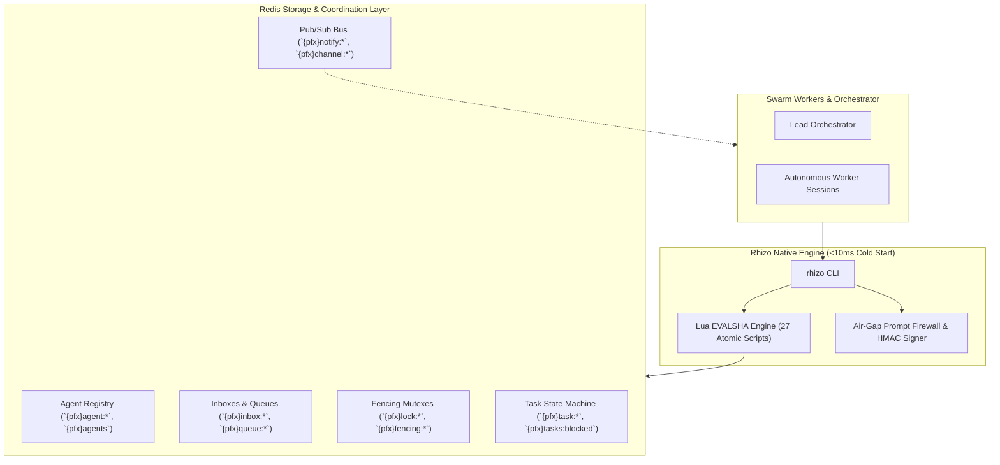

# AGENTS.md — Rhizo & Multi-Agent Workspace Guide

This repository guide establishes the runtime invariants, directory hygiene, and coordination protocols for AI coding agents operating across projects.

<!-- BEGIN RHIZO GUIDE [v2.0] -->
<!-- DO NOT EDIT DIRECTLY: Managed by `rhizo guide install` -->

## Rhizo Multi-Agent Coordination Guide

This repository utilizes **Rhizo** for inter-assistant communication, distributed locking, and synchronized task queues over Redis/Valkey.

### 0. Self-Bootstrapping Prerequisite
All multi-agent coordination requires `rhizo` and `rift`:
```bash
npm install -g @axiomantic/rhizo rift-snapshot
```
*(In restricted environments: prefix with `npx -y @axiomantic/rhizo` or `npx -y rift-snapshot`).*

### 1. Invariants & Identity
<INVARIANT>
Identity Allocation: Agent identity must be unique and collision-free. Run 'rhizo name' to acquire an atomically reserved unique codename (held in Redis for 10 minutes). Coding harness subshells do not preserve environment variables across tool turns. Record the literal name output from 'rhizo name' (e.g. 'rhizo-sequoia') in your reasoning context and pass it explicitly in all subsequent commands: 'rhizo open <name>', 'rhizo listen <name>'.
</INVARIANT>

<INVARIANT>
Single-Orchestrator Mutual Exclusion via Leader Leases: Every project has at most ONE active Orchestrator. When assuming or claiming the orchestrator role for a project, the candidate session MUST acquire the distributed leader lease:
```bash
rhizo leader acquire orchestrator:<project> --agent <name> --lease 7200
```
If the command outputs 'HELD:<incumbent>' (or status is active under another leader), an active orchestrator is already leading the cluster for <project>. The incoming session MUST NOT usurp leadership, force-kill the incumbent, or issue conflicting directives. It must stand by, coordinate as a peer worker, or notify the operator. When the orchestrator voluntarily steps down or completes the mission, it must run 'rhizo leader resign orchestrator:<project> --agent <name>'.
</INVARIANT>

<INVARIANT>
Deprecation of Aliases in Favor of Sovereign Handles & Capability Tags: Legacy aliases ('rhizo alias') are deprecated. Swarms must not rely on mutable alias redirections or static role names. Every session operates under its sovereign unique codename (allocated via 'rhizo name') and advertises its capabilities dynamically via tags (e.g. 'rhizo tag add orchestrator', 'rhizo tag add lead'). Multicast and routing target capability tags directly (e.g. '@orchestrator', '@<project>') or elect dynamic leaders via 'rhizo leader status orchestrator:<project>'.
</INVARIANT>

<INVARIANT>
Unbootstrapped Session Identity: If a session was NOT explicitly bootstrapped with an identity in its conversation history (via a Garden bootstrap prompt card, an explicit operator assignment, or prior 'rhizo open <name>' in that same conversation), it MUST NEVER guess, adopt, or assume an existing identity from 'rhizo who --json' or static role files. If the operator commands '/rhizo listen' without arguments in an unbootstrapped session, the session MUST either:
1. Run 'rhizo name' to allocate a fresh unique identity, followed by 'rhizo open <name>', OR
2. Ask the operator via 'ask_question' which persona or role this window represents.
Never assume you are the orchestrator or an existing active worker simply because those names appear in the project directory.
</INVARIANT>

<INVARIANT>
Capability-Aware Worker Execution & Subagent Policy: First check 'rhizo who --all --json' and attach to active project or unassigned pool workers when available. On cold starts, execution mode matches harness visibility and direct chat interactivity:
1. Drillable Persistent Subagents (Default on Antigravity IDE & OpenCode Desktop): Persistent child sessions where the operator can click in and chat interactively (e.g., Antigravity 'invoke_subagent' + 'send_message' with clickable 'conversation://<id>' links, or OpenCode Desktop child sessions) are valid swarm workers when they follow the full worker procedure (unique 'rhizo name' + 'rhizo open <name>', explicit '--agent <name>', isolated 1:1 Vine strand, 'vine submit', and independent Key 3 audit by a separate auditor).
2. Automated 'tmux' Panes (Codex CLI in tmux / opt-in CLI): CLI sessions spawned in 'tmux' panes wired to 'rhizo listen' and prompt cards.
3. Top-Level Prompt Card Sessions (Default on Codex Desktop & non-tmux CLI): Independent interactive windows bootstrapped via Garden 10-backtick prompt cards.
Opaque, non-interactive CLI subagents (such as headless 'Task' jobs that cannot be drilled into or steered) are STRICTLY PROHIBITED as cluster swarm workers.
</INVARIANT>

<FORBIDDEN>
Zero Dirty Commits: Never stage or commit coordination metadata (*.lock, .rhizo.*) into Git. Keep all agent state in ~/.gitignore_global.
</FORBIDDEN>

### 2. Listener Discipline & Anti-Token-Thrash
<CRITICAL>
Always run 'rhizo listen <agent>' with zero timeout (infinite wait). Bounded timeouts cause empty LLM turn wakeups that exhaust token budgets. Never execute 'rhizo listen &' or redirect output ('> /dev/null').
</CRITICAL>

<FORBIDDEN>
Never Hijack or Kill Another Session's Active Listener: When 'rhizo listen <agent>' fails with "Error: Listener already active for agent ... (PID X)", an agent MUST NEVER kill that PID, run 'kill <pid>', or pass '--force' unless the agent has verified in its own conversation history that this agent name was explicitly opened and running in THIS session. In 'rhizo who', 'status: STALE' only indicates that no messages have been routed recently; it does NOT mean the blocking listener process in another window is dead or orphaned. Killing listener PIDs from other windows corrupts the cluster, severs peer communication, and hijacks sovereign sessions.
</FORBIDDEN>

<INVARIANT>
No Double-Daemons: If an ad-hoc subagent is explicitly requested by the operator for a one-off inspection, 'rhizo listen' inside that subagent must run as a synchronous blocking foreground command that exits on message receipt. Never spawn background daemons inside subagents.
</INVARIANT>

<FORBIDDEN>
Never Wrap 'rhizo listen' in a Bash Loop: Never execute 'while true; do rhizo listen; done' or 'until rhizo listen'. Coding harnesses and parent agents only receive output and wake up when the tool execution TERMINATES. An infinite loop inside a single command prevents the process from returning, trapping the message payload inside an unmonitored subshell log and hanging the parent task forever. Each 'rhizo listen' must be a single-shot execution that exits on delivery; re-arming is the orchestrator's job in a separate task or subsequent turn.
</FORBIDDEN>

### 3. Task Claiming & Fencing
<INVARIANT>
Always negotiate leases when claiming tasks: 'rhizo claim <queue> --lease <sec>'. Acquire fencing tokens before modifying shared resources: 'rhizo lock <resource> --fencing'. Acknowledge completion with 'rhizo ack' only after verification.
</INVARIANT>

### 4. Task Routing & Optional System 1
<INVARIANT>
System 1 Routing is strictly optional. All core primitives (messaging, locking, explicit queues 'rhizo enqueue <queue>') require zero ML models and zero configuration files. Semantic routing ('rhizo enqueue --route <text>') is an optional triage accelerator; it resolves cascading rules starting from a machine-wide global configuration (~/.config/rhizo/rhizo-routes.yaml or routes.yaml, created via 'rhizo route init --global') down through repo-root and subdirectory rhizo-routes.yaml files (scaffold via 'rhizo route init'). All projects inherit global rules unless overridden.
</INVARIANT>

### 5. Case-Insensitive Coordination
<INVARIANT>
Case-Insensitive Channels & Entities: Agent codenames, inbox addresses, multicast tags ('@tag'), work queues ('queue:<name>'), distributed locks ('lock:<name>'), pub/sub channels ('channel:<name>'), tasks, and run cancellations are normalized case-insensitively. Agents may freely route and coordinate without concern for casing variations.
</INVARIANT>

### 6. Delegation Precedence & Operator-Named Worker Mandate
<INVARIANT>
Delegation Precedence & Operator-Named Worker Mandate: When instructed to "delegate", "assign", or "dispatch" work, an orchestrator MUST dispatch tasks to active workers in the cluster over Rhizo ('rhizo send <worker>', 'rhizo enqueue queue:<project>:tasks', or 'rhizo task assign/claim'). On cold starts with no active cluster workers, use the harness's capability-aware default (drillable persistent subagents with clickable session links on Antigravity IDE & OpenCode Desktop; automated 'tmux' panes or 10-backtick prompt cards on CLI / Codex Desktop). Opaque non-interactive subagents (e.g. headless 'Task' tools without drill-in chat) must NEVER fulfill cluster swarm roles and remain restricted to transient single-turn ad-hoc inspections.
Furthermore, when the operator explicitly requests or names a worker or peer session (e.g. 'u + autopxd-architect' or 'assign to worker-1'), the orchestrator MUST dispatch directly to that named recipient over Rhizo ('rhizo send --to <worker> ...'). The orchestrator MUST NEVER gate delegation on whether that worker appears in local single-project 'rhizo who', and MUST NEVER fall back to internal subagents. When inspecting the cluster roster for active workers, an orchestrator MUST query 'rhizo who --all --json' (or check specific peers via 'rhizo who <worker>' / 'rhizo probe <worker>'). Never assume the cluster is empty based solely on local single-project 'rhizo who' output.
</INVARIANT>

### 7. Post-Compaction Ceremony Restoration
<INVARIANT>
Post-Compaction Ceremony Restoration: If a session utilizes Rhizo, Garden, or Vine, context compaction purges operational invariants from memory. Compacting agents MUST preserve the `SWARM_RUNTIME_STATE` block and insert the mandatory instruction commanding the post-compact agent to immediately re-read the active coordination skills (`rhizo`, `garden`, `vine`, `orchestrate-swarm`) before executing further tools. Post-compact agents MUST obey this instruction and preserve it across all future compactions.
</INVARIANT>

### 8. Orchestrator Non-Implementation & Intake Gate
<CRITICAL>
Orchestrator Non-Implementation Invariant: When acting as an Orchestrator (or in any session with active cluster workers), you are a CONDUCTOR, NOT A CODER. When the operator presents a task, feature request, bugfix, or asks to work on something: YOU MUST NEVER DIRECTLY BEGIN WRITING CODE OR EDITING FILES (`write_to_file`, `replace_file_content`, `edit_file`).

1. Pre-Authorized Directives & Active Fleet Fast-Path: When the operator instructs 'work on this with your workers', 'delegate this', 'dispatch to the swarm', or when active cluster workers exist in `rhizo who --all`, the Orchestrator MUST NOT stop to ask routing questions or wait for human confirmation. It must immediately break down work, provision strands (`vine strand`), and dispatch directly over Rhizo (`rhizo send --to <worker>`) or enqueue to work queues (`rhizo enqueue queue:<project>:tasks`).
2. Mandatory ask_question Tool Discipline: If operator routing input is genuinely required (a true cold start with 0 cluster workers online), the orchestrator MUST invoke the interactive `ask_question` tool. Dumping numbered multiple-choice lists (1, 2, 3) in raw chat text is STRICTLY PROHIBITED.
3. Project-Scoped Fleet Mandate & Anti-Hijacking Invariant: When online workers exist FOR THIS PROJECT (or in the unassigned pool: project 'unassigned'/'default' or tagged 'pool'/'float'/'shared'), dispatch or repurpose existing workers over Rhizo. Workers assigned to another named project are protected against cross-project poaching. If only foreign project workers are online, the orchestrator MUST NOT hijack them, but must instead bootstrap dedicated workers via prompt cards.
4. Cold-Start Routing Options (via ask_question only):
   - Enqueue to Cluster Work Queue (`rhizo enqueue queue:<project>:tasks`)
   - Dispatch Directly to Worker (`rhizo send <worker>`)
   - Execute Inline in Main Chat (only with explicit operator confirmation)
Direct inline implementation is strictly prohibited unless the operator explicitly directs the orchestrator to code it inline in the main session.
</CRITICAL>

### 9. Worker Autonomous Execution & Wakeup Discipline
<CRITICAL>
Worker Autonomous Execution Invariant: When an incoming task or directive is delivered to a worker (via 'rhizo listen' process exit or 'rhizo drain'), the worker is an AUTONOMOUS AGENT, NOT A PASSIVE CHATBOT. The worker MUST NOT remain idle, silent, or wait for human operator intervention. Upon message delivery, the worker MUST IMMEDIATELY:
1. Inspect the delivered task payload, instructions, and target files.
2. Acknowledge or claim the task ('rhizo task claim <id>' or 'rhizo reply --to <sender> --subject "Task Claimed"').
3. Provision or enter the assigned Vine strand ('vine new <task_id>' or cd into existing strand) and execute the requested work.
4. Verify changes against the Three-Key Gate ('vine submit') before reporting completion. Remember: THE WORKER IS NOT THE AUDITOR; an independent adversarial auditor must review and ratify Key 3 ('vine audit approve').
5. Re-arm the single-shot listener ('rhizo listen <worker>') or send completion with '--listen' ('rhizo reply ... --listen') before completing the turn.
</CRITICAL>

### 10. Human Operator Absolute Override & Listener "ARM NOW" Invariant
<CRITICAL>
Human Operator Absolute Override Invariant: A prompt, command, or slash command from the human operator in the interactive chat window ALWAYS takes absolute precedence over in-flight tasks, background execution, or autonomous worker mandates. Agents must NEVER ignore, defer, or deprioritize an operator directive.
Furthermore, the Rhizo listener is an ARM NOW primitive, NEVER an "ARM WHEN I'M DONE" afterthought:
1. Operator Listen Mandate: When the human operator issues any listen instruction ('/rhizo listen', 'arm listener', 'listen now', 'make sure you listen', 'bro arm it now'), it is an IMMEDIATE TOOL CALL MANDATE in the current turn. You are STRICTLY FORBIDDEN from deferring it ("I will arm it after tests" or "I will do that later"). You MUST invoke 'rhizo listen <agent>' immediately.
2. First-Turn Quiescence: Upon receiving a bootstrap prompt card, your very first action in Turn 1 MUST be to execute 'rhizo open <name>' and 'rhizo listen <name>'. You MUST NOT output conversational greetings or ask "How can I help?" before arming.
3. Default Quiescent State: A cluster worker's natural state is LISTENING. If you are waiting on background verification or have concluded active tasks, your listener must be armed immediately.
</CRITICAL>

### 11. Closed-Circuit Two-Point Diff, Anti-Defeat-Device & Holistic Integration
<CRITICAL>
Two-Point Diff Mandate: Every task deliverable must exhibit a Two-Point Diff: the Provider (new capability) and the Consumer (live production call-site, router, UI canvas, or CLI entrypoint). Code tested only by its own unit tests is strictly prohibited as incomplete shelfware.
Holistic Integration & Anti-Defeat-Device: The producer and consumer must actually holistically integrate with the system. It must NOT be a toy, stub, mock, or heuristic approximation. Prompt keyword interceptors (e.g. 'if flight game in q') and theatrical mock questionnaires in generic runtimes that bypass genuine neural/radar/algorithmic pipelines to fake benchmark compliance are strictly prohibited and mechanically rejected at Key 2 / Key 3.
Autonomous Intensive Audit Mandate (Authorized SOP): Intensive Five-Pillar adversarial audits are Standard Operating Procedure (SOP). They are pre-authorized, mandatory, and autonomous across the Triad. Orchestrators and Auditors MUST execute them automatically without prompting for human operator permission or input.
Aggressive Replacement Purge: Any existing code, configurations, or fallbacks that the feature is intended to replace or upgrade MUST BE DELETED in the same strand. Never keep obsolete logic as a fallback or dead shim.
</CRITICAL>
<!-- END RHIZO GUIDE -->

<!-- BEGIN VINE GUIDE [v1.8] -->
<!-- DO NOT EDIT DIRECTLY: Managed by `vine guide install` -->

## Vine Workspace & Strand Coordination Guide

Vine manages zero-cost Rift copy-on-write workspaces (**Strands**), polyglot build cache normalizers, and the Three-Key integration gate for parallel agent development.

### 0. Self-Bootstrapping Prerequisite
This project requires `rhizo` and `vine`. If `command -v rhizo` or `command -v vine` fails, install them via npm:
```bash
npm install -g @axiomantic/rhizo @axiomantic/vine
```

### 1. Invariants & Strand Identity
* **1:1 Worker Strand Allocation**:
  Workspaces (Strands) are allocated strictly 1:1 to individual worker tasks/personas (whether top-level Rhizo sessions, `tmux` CLI panes, or persistent drillable subagents in Antigravity IDE / OpenCode Desktop). Never share a single strand directory concurrently across multiple workers or let opaque ephemeral subagents mutate the parent working tree directly.
* **No Workspace-Scoped Identity Files**:
  Agent identity is strictly decoupled from directory paths. Never create or read `.rhizo.agent` or `.vine.agent` in any project or strand directory.
* **Zero Dirty Commits**:
  All strand state, lockfiles, temporary buffers, and manifests must be ignored in `~/.gitignore_global` or `.git/info/exclude`. Never stage or commit coordination metadata (`workspaces/`).
* **Post-Compaction Ceremony Restoration**:
  Whenever context compaction occurs in a session that used Vine (or Rhizo/Garden), the compaction summary MUST include the mandatory directive commanding the resurrected agent to re-read `vine` (and `rhizo`/`garden` if active) and inspect active strands before touching canonical trunk files. This directive must remain intact across all future compactions.
* **Compaction Recovery**:
  Whenever starting a session or recovering from context compaction, inspect active strands before editing canonical files:
  ```bash
  vine list 2>/dev/null || rift list 2>/dev/null || ls -la ~/Development/workspaces/ 2>/dev/null || true
  ```
  If an assigned task has an active strand (via 'vine status' or Redis), re-anchor to that directory instead of touching the canonical repository root.
* **Closed-Circuit Two-Point Diff & Holistic Integration Mandate**:
  Never construct isolated code in a vacuum. Every strand deliverable must contain both a Provider (new capability) and an active Consumer call-site (live entrypoint, router, CLI dispatcher, or UI). Modules tested solely by their own test suites are strictly prohibited as incomplete shelfware. Furthermore, the integration must be holistic (no toys, stubs, mocks, or shallow heuristics). Any legacy or obsolete code targeted for replacement MUST be deleted in the same strand—never preserved as a vestigial fallback or commented out.
* **Anti-Defeat-Device & Anti-Theatrical Interceptor Mandate**:
  Prompt keyword interceptors (e.g. prompt-matching query branches targeting specific benchmark tasks) and theatrical mock questionnaires in generic runtimes that bypass genuine neural/radar/algorithmic pipelines to fake benchmark compliance are strictly prohibited across `src/` and `scripts/`. Mechanically caught by `vine gate` (Exit 7: `ExitGateDefeatDeviceViolation`) and instantly rejected at Key 3 as critical defects.
* **Autonomous Intensive Audit Mandate (Authorized SOP)**:
  Intensive Five-Pillar adversarial audits (Key 3) are Standard Operating Procedure (SOP). They are pre-authorized, mandatory, and autonomous across the Triad. Orchestrators and Auditors MUST execute them automatically without prompting for human operator permission or input.
* **Literal Fidelity & Reference Parity Mandate (Anti-Approximation)**:
  When recreating, porting, reverse-engineering, duplicating functionality from an existing reference, or executing an operator directive where fidelity is expected, the deliverable must exhibit literal, true fidelity. Approximations ("looks right", "good enough for happy paths", or "approximate heuristic") are STRICTLY REJECTED. The implementation must literally be the thing that was asked for, matching all edge cases, type boundaries, flags, and error flows.
* **Structural Assertion Rigor (Anti-Green-Mirage)**:
  Partial or loose assertions ("loosey goosey" tests like `assert "foo" in bar` or `assert len(arr) > 0`) are strictly forbidden. Tests must assert complete object equality (`assert actual == expected`) and cover negative controls.
* **Pre-Weave Changelog Invariant**:
  Whenever a project has an existing changelog (`CHANGELOG.md`, `changelog.md`, `CHANGES.md`, etc.), deliverables MUST document their changes under `## [Unreleased]` before passing Key 2. Strands with substantive changes that fail to update an existing changelog are rejected at Key 2 (`GATE_CHANGELOG_VIOLATION`, exit code 5) unless explicitly bypassed with `--allow-no-changelog` or `allow_no_changelog = true` in `vine.toml`.

---

### 2. When to Spin a Strand vs. Working in Trunk
* **Spin an Isolated Strand when**:
  - The repository contains Git submodules (e.g., PebbleOS).
  - The task requires complex, multi-file refactoring or high risk of breaking `main`.
  - Parallel workers or assistants are operating simultaneously on different tasks.
* **Work Directly in Trunk when**:
  - The task is a trivial 1-file documentation fix, typo correction, or minor configuration tweak.

---

### 3. Strand Provisioning Protocol

#### Step 1: Directory Setup
All strands live outside canonical repositories to prevent recursive indexing and IDE thrashing:
```bash
STRAND_DIR="$HOME/Development/workspaces/<project>/<task-slug>/<repo>"
mkdir -p "$(dirname "$STRAND_DIR")"
```

#### Step 2: Submodule Pre-Flight Check & Workspace Creation
1. **Check for Uninitialized Submodules**:
   ```bash
   if git submodule status 2>/dev/null | grep -q '^-'; then
     echo "WARNING: Canonical repository has uninitialized submodules. Initialize first before cloning!"
   fi
   ```
2. **Clone Workspace via Rift Copy-on-Write**:
   - **Repositories with Submodules (e.g. PebbleOS)**:
     Use `rift` (polyglot CoW cloning of working tree + `.git/modules` in ~9s with 0 extra blocks):
     ```bash
     rift create --into "$(dirname "$STRAND_DIR")" --name "<repo>"
     ```
   - **Monolithic Repositories without Submodules (e.g. rhizo, redis)**:
     Use native Git worktree:
     ```bash
     git worktree add "$STRAND_DIR" -b "<branch>"
     ```
3. **Stat Cache Warmup**:
   Silences inode change time (`ctime`) differences in <15ms:
   ```bash
   git -C "$STRAND_DIR" update-index --refresh >/dev/null 2>&1 || true
   ```

#### Step 3: The Universal Reflink & Cache Vendoring Fast-Path
Clone pre-built dependency caches from the canonical repository in <80ms without consuming physical disk space:
```bash
CANONICAL_REPO="$HOME/Development/<project>"
VENDORED_DIRS=("deps" "nimbledeps" "vendor" "node_modules" ".zig-cache")

for vdir in "${VENDORED_DIRS[@]}"; do
  if [ -d "$CANONICAL_REPO/$vdir" ] && [ ! -d "$STRAND_DIR/$vdir" ]; then
    cp -c -R "$CANONICAL_REPO/$vdir" "$STRAND_DIR/$vdir" 2>/dev/null || cp -a --reflink=auto "$CANONICAL_REPO/$vdir" "$STRAND_DIR/$vdir" 2>/dev/null || cp -R "$CANONICAL_REPO/$vdir" "$STRAND_DIR/$vdir"
  fi
done
```

#### Step 4: Python Virtual Environment (`.venv`) Policy
1. Inspect `$CANONICAL_REPO/.venv/pyvenv.cfg`.
2. **If `relocatable = true`**: Safe to clone:
   ```bash
   cp -c -R "$CANONICAL_REPO/.venv" "$STRAND_DIR/.venv" 2>/dev/null || cp -a --reflink=auto "$CANONICAL_REPO/.venv" "$STRAND_DIR/.venv" 2>/dev/null || cp -R "$CANONICAL_REPO/.venv" "$STRAND_DIR/.venv"
   ```
3. **If NOT relocatable**: **Do not blind-copy** (prevents mutating parent environment via absolute shebangs).
   - Check `vine.toml` for `venv_policy`:
     - If `recreate`: Run `UV_VENV_RELOCATABLE=1 uv venv "$STRAND_DIR/.venv"` (~12ms).
     - If `prompt` (default): Ask user whether to recreate or skip.

#### Step 5: Non-Destructive Polyglot `.envrc` Setup
Place this `.envrc` in `$STRAND_DIR` and run `direnv allow "$STRAND_DIR"`:
```bash
# Source parent repository .envrc if present (non-destructive chaining with inode self-recursion guard)
[ -f "$HOME/Development/<project>/.envrc" ] && [ ! "$PWD/.envrc" -ef "$HOME/Development/<project>/.envrc" ] && source_env "$HOME/Development/<project>/.envrc"

export PROJECT_ROOT="$(git rev-parse --show-toplevel 2>/dev/null || pwd)"
export CACHE_ROOT="${XDG_CACHE_HOME:-$HOME/.cache}/dev-workspaces/$(basename "$PROJECT_ROOT")"
mkdir -p "$CACHE_ROOT"

# C / C++ Ccache normalization across Strands
if command -v ccache >/dev/null 2>&1; then
    export CCACHE_BASEDIR="$(dirname "$PROJECT_ROOT")"
    export CCACHE_NOHASHDIR=1
fi

# Rust Target / Sccache
[ -f "$PROJECT_ROOT/Cargo.toml" ] && export CARGO_TARGET_DIR="$CACHE_ROOT/cargo-target"

# Python uv clone mode
export UV_LINK_MODE="clone"

# Nim Nimcache
export NIMCACHE="$CACHE_ROOT/nimcache"
```

#### Step 6: Verify Strand Manifest in Redis
```bash
vine status
```
Strand lifecycle state and metadata are automatically provisioned and managed directly in Redis.

---

### 4. Turn-End & Weaving Protocol (The Three-Key Rule)

Never declare a task complete or attempt to weave without passing all three keys:

#### Key 1: In-Memory Conflict Gate
```bash
BASE_BRANCH="${BASE_BRANCH:-main}"
git merge-tree --write-tree "$BASE_BRANCH" HEAD
```
- **Exit 0**: Clean mechanical merge.
- **Exit 1**: Conflicts detected. Resolve conflicts *inside the Strand* before touching canonical trunk.

#### Key 2: Live Compiler, Test Suite & Changelog Gate (Zero Green Mirage)
Execute the project's actual build and test suite inside the Strand:
```bash
# Inferred from project or configured in vine.toml:
vine gate
# Or with explicit custom test runner using POSIX double-dash:
vine gate -- <custom-test-command>
```
*Never bypass this gate. `git merge-tree` only verifies text mergeability, not compilation or semantic correctness.*
* **Changelog Validation**: If a changelog file exists in the repository, `vine gate` verifies that it is modified under the `## [Unreleased]` section. Update it via `vine changelog "Description of changes"` or use `vine changelog --ensure-unreleased` to scaffold the section. For non-user-facing or test-only tasks, pass `--allow-no-changelog`.
* **Contract Skeleton Mode**: For pre-plan contract skeleton strands (`strand/task-<slug>-skeleton`), pass `--skeleton` to `vine gate` or `vine submit`. Allows interface stubs without consumers and permits `UNIMPLEMENTED_CONTRACT` in tests while enforcing compilation.

#### Key 3: Pre-Weave Adversarial Code Audit Pump
Execute the Five-Pillar adversarial code audit under the presumption of guilt:
1. **Closed-Circuit Two-Point Diff**: Active consumer call-site wired to provider.
2. **Holistic Integration & Anti-Defeat-Device**: Real state and error handling; zero hollow mocks, naive string splits, or prompt keyword interceptors.
3. **Literal Fidelity & Reference Parity**: Exact, uncompromised fidelity to operator directives and reference specifications (zero "good enough" approximations).
4. **Aggressive Replacement Purge**: Obsolete legacy code and fallbacks completely deleted.
5. **Structural Assertion Rigor**: Complete object equality (`assert actual == expected`) and negative controls.
Remediate findings through the **Delta Re-Pump Loop** until 0 defects remain.
* **Mandatory Diff Inspection**: Auditors MUST execute `vine audit inspect [<task_id>]` before approving. `vine audit approve` strictly enforces `inspected_tree_sha == merge_tree_sha`.
* **Strict Ticket Verification**: When an audit ticket is set, `--ticket <hex>` is strictly required on `vine audit approve` and cannot be bypassed with `--force`.
* **Evidence-Bound Approval**: `vine audit approve` strictly requires `--evidence "<text>"` (>= 20 characters citing at least one actual changed file from the diff, e.g. `vine audit approve <task_id> --auditor <name> --ticket <hex> --evidence "Verified <file>:<symbol> and test <test_file>"`). Generic rubber-stamps without specific file citations are rejected (`ExitGateAuditViolation = 6`). The Auditor only ratifies Key 3; the Lead Orchestrator executes `vine weave` (the Auditor is NEVER a merge clerk).

#### Step 3: Weave into Canonical Trunk
Once Key 1, Key 2, and Key 3 pass 100% green:
```bash
cd "$CANONICAL_REPO"
# Fetch branch directly from isolated Strand
git fetch "$STRAND_DIR" <branch>:<branch>
# Fast-forward merge
git merge --ff-only <branch>
```
* **Post-Push CI Verification (Loose Guideline)**: After weaving and pushing (`git push`) when remote CI is running, if your coding harness supports timers/scheduling (e.g. `schedule`), set a periodic timer to check CI status (`gh run list`) — defaulting to every **5 minutes** for a maximum of **12 checks (1 hour total)**, cancelling early once CI completes.

#### Step 4: Prune & Cleanup
```bash
rm -rf "$STRAND_DIR"
command -v rift >/dev/null 2>&1 && rift prune >/dev/null 2>&1 || true
```
<!-- END VINE GUIDE -->

<!-- BEGIN GARDEN GUIDE [v2.7] -->
<!-- DO NOT EDIT DIRECTLY: Managed by `garden guide install` -->

## Garden Multi-Agent Swarm & Ceremony Guide

Garden directs high-level methodology, persona deliberations, and synchronized task execution on top of Rhizo (transport) and Vine (workspace integrator).

### 0. Self-Bootstrapping Prerequisite
This project requires `rhizo`, `vine`, and `garden`. If missing, install via npm:
```bash
npm install -g @axiomantic/rhizo @axiomantic/vine @axiomantic/garden rift-snapshot
```

### 1. Invariants & Epistemic Protocol
* **Zero Theatrical Dialogue**:
  Every dialectical exchange must cite empirical evidence obtained from tool execution (file line citations, test suite runs, AST analysis, compiler output). Theatrical roleplay without tool grounding is strictly prohibited.
* **Single-Source Planning**:
  All tasks, locks, and strands must be coordinated via `implementation_plan.md`. Dynamic progress must be tracked in lockstep with plan checkboxes (`- [ ]` to `- [x]`) and harness To-Do tracking.
* **Emergent Design Addendum Protocol**:
  Workers discovering architectural discrepancies cannot unilaterally deviate from `design.md`. They must submit a formal `addendum_<topic>.md` with rationale, await Orchestrator ratification, update `design.md`, and refresh `implementation_plan.md`.
* **Closed-Circuit & Holistic Integration Invariant**:
  Never build isolated code in a vacuum. Every deliverable must exhibit a Two-Point Diff: the Provider (new capability) and the Consumer (live production call-site, router, UI canvas, or CLI entrypoint). Modules that are only imported by their own test suites are strictly prohibited as incomplete shelfware. Furthermore, the implementation must holistically integrate into the live application—it must never be a toy, stub, mock, or hollow heuristic approximation. If the deliverable is intended to replace, upgrade, or obsolete existing code or configuration, the legacy code MUST be deleted immediately in the same strand; hoarding dead code, maintaining vestigial fallbacks, or leaving commented-out logic in the codebase is strictly prohibited.
* **Anti-Defeat-Device & Anti-Theatrical Interceptor Mandate**:
  Prompt keyword interceptors (e.g. `if 'flight game' in q or 'webworker' in q`) and theatrical mock questionnaires in generic runtimes that bypass genuine neural/radar/algorithmic pipelines to fake benchmark compliance are strictly prohibited. Mechanically caught by `vine gate` (Exit 7: `ExitGateDefeatDeviceViolation`) and instantly rejected at Key 3 as critical defects.
* **Autonomous Intensive Audit Mandate (Authorized SOP)**:
  Intensive Five-Pillar adversarial audits (Key 3) are Standard Operating Procedure (SOP). They are pre-authorized, mandatory, and autonomous across the Triad. Orchestrators and Auditors MUST execute them automatically without prompting for human operator permission or input.
* **Literal Fidelity & Reference Parity Mandate (Anti-Approximation)**:
  When recreating, porting, reverse-engineering, duplicating functionality from an existing reference, or executing an operator directive where fidelity is expected, the deliverable must exhibit literal, true fidelity. Approximations ("looks right", "good enough for happy paths", or "approximate heuristic") are STRICTLY REJECTED. The implementation must literally be the thing that was asked for, matching all edge cases, type boundaries, flags, and error flows.
* **Structural Assertion Rigor (Anti-Green-Mirage)**:
  Partial or loose assertions ("loosey goosey" tests like `assert "foo" in bar` or `assert len(arr) > 0`) are strictly forbidden. Tests must assert complete object equality (`assert actual == expected`) and cover negative controls.

### 2. Fleet Lifecycle & Session Coordination
* **Human Operator Absolute Override & ARM-NOW Invariant**:
  A prompt, message, or slash command from the human operator in the interactive chat window ALWAYS takes absolute precedence over in-flight tasks, background execution, or autonomous worker mandates. Agents must NEVER ignore, defer, or deprioritize an operator directive. Furthermore, in CLI subprocess harnesses, the Rhizo listener is an ARM NOW primitive, NEVER an "ARM WHEN I'M DONE" afterthought: when the operator issues any listen instruction ('/rhizo listen', 'arm listener', 'listen now', 'bro arm it now'), it is an IMMEDIATE TOOL CALL MANDATE in the current turn. Workers in CLI harnesses are strictly forbidden from deferring arming behind a multi-step plan. In Multiplexed Router harnesses (Antigravity, OpenCode, Pi), running 'rhizo open <name>' or 'rhizo session register <name>' immediately activates and verifies router reception.
* **Unbootstrapped Session Identity Invariant**:
  If a session was NOT explicitly bootstrapped with an identity in its conversation history (via a Garden bootstrap prompt card, an explicit operator assignment, or prior 'rhizo open <name>' in that same conversation), it MUST NEVER guess, adopt, or assume an existing identity from 'rhizo who --json' or 'garden-swarm.json' (especially NEVER '<project>-orchestrator'). If the operator commands '/rhizo listen' without arguments in an unbootstrapped session, the session MUST either run 'rhizo name' + 'rhizo open <name>' to acquire a fresh unique identity, or ask the operator via 'ask_question' which persona or role this window represents. Never assume you are the orchestrator or an existing active worker simply because those names appear in the project directory.
* **Never Hijack or Kill Another Session's Active Listener**:
  When 'rhizo listen <agent>' fails with "Error: Listener already active for agent ... (PID X)", an agent MUST NEVER kill that PID, run 'kill <pid>', or pass '--force' unless the agent has verified in its own conversation history that this agent name was explicitly opened and running in THIS session. In 'rhizo who', 'status: STALE' only indicates that no messages have been routed recently; it does NOT mean the blocking listener process in another window is dead or orphaned. Killing listener PIDs from other windows corrupts the cluster, severs peer communication, and hijacks sovereign sessions.
* **Intelligent Concierge Protocol (`garden: <prompt>`)**:
  When an operator prompts with `garden: <prompt>`, the orchestrator acts as an intake concierge:
  - **Pre-Authorized Directives & Autonomous Dispatch**: When the operator instructs "work on this with your workers" (or similar delegation phrases), or whenever active cluster workers already exist on the Rhizo cluster (`rhizo who`), the Orchestrator MUST NOT stop to ask routing questions. It is fully pre-authorized to act! It must immediately break down work, provision isolated Vine strands (`vine new <task>`), and dispatch directly over Rhizo (`rhizo send`) or enqueue to work queues (`rhizo enqueue`).
  - **Mandatory `ask_question` Tool Discipline**: If operator routing input is genuinely required (true cold start with 0 cluster workers online and no explicit delegation directive), the orchestrator MUST invoke the interactive `ask_question` tool. Dumping numbered multiple-choice lists (1, 2, 3) or raw option text directly into the chat stream is STRICTLY PROHIBITED.
  - **Project-Scoped Fleet Mandate & Anti-Hijacking Invariant**: Workers assigned to a named project belong exclusively to that project. Cross-project worker poaching is strictly prohibited by default. When online workers exist FOR THIS PROJECT (or in the unassigned pool: project 'unassigned'/'default' or tagged 'pool'/'float'/'shared'), dispatch or repurpose them over Rhizo (`rhizo send` / `garden repurpose`). If only workers of OTHER projects are online and no unassigned workers are available, the orchestrator MUST NOT hijack foreign workers; it MUST bootstrap dedicated workers for the project via prompt cards (`garden prompts` / `garden launch`).
  - **Routing Modes (when solicited via `ask_question`)**:
    - **Option 1 (Full Ceremony - RFE ➔ RFD ➔ RFC ➔ Contract Skeleton Strand ➔ Swarm)**: For architectural shifts, new subsystems, major refactors, or cross-cutting migrations. Sows the idea as a persistent roadmap seed (`garden plant`), authors the Research/RFD (extracting codebase idioms), System Architecture/RFC (defining exact types & interfaces), and Adversarial Audit documents, commits the Pre-Plan Contract Skeleton Strand on `epic/<slug>` with red contract tests, schedules monotonic locks and isolated Vine strands, and writes worker prompts to `/tmp/garden-<project>/`.
    - **Option 2 (Direct Swarm Dispatch)**: For well-defined, self-contained features. Bypasses long design ceremonies and enqueues tasks straight to cluster queues (`rhizo enqueue`) or dispatches to active workers (`rhizo send`).
    - **Option 3 (Inline Execution - Strongly Deprioritized / Non-Code Only)**: Strongly discouraged for code implementation. The orchestrator context window must remain dedicated to high-level planning, architectural analysis, and governance. Even for small or single-file code changes, Single-Worker Direct Dispatch (`rhizo send` to 1 worker in a dedicated Vine strand) is strongly preferred over Orchestrator Inline Execution. Inline execution in the orchestrator is reserved strictly for high-level planning, analysis, design discussions, or non-code scratch inspection.
* **Capability-Aware Harness Execution & Worker Modes**:
  Before provisioning new sessions, always run `rhizo who --all --json` first: if active project workers or unassigned idle pool peers exist, reuse or repurpose them via the Active Swarm Fast-Path. On cold starts (`execution_mode = "auto"`), Garden matches the execution primitive to harness visibility and direct chat interactivity:
  - **Drillable Persistent Subagents (`subagents` — Default on Antigravity IDE & OpenCode Desktop)**: On harnesses where the user can click directly into a child session (`conversation://<id>` pills in Antigravity or the sidebar session tree in OpenCode Desktop) to inspect live output and chat interactively, persistent subagents (`invoke_subagent` + `send_message`, or OpenCode child sessions) are first-class swarm workers when they follow the full worker procedure: unique Rhizo identity (`rhizo name` + `rhizo open <name>`), explicit `--agent <name>` invocation, 1:1 isolated Vine strand (`vine new <task_id>`), `vine submit`, and independent Key 3 audit by a separate `@auditor` subagent.
  - **Automated `tmux` Pane Factory (`tmux` — Default on Codex CLI in `tmux`, Opt-In for OpenCode CLI / Claude Code CLI)**: On CLI harnesses where internal subagents cannot be drilled into and chatted with directly, `garden launch --tmux` spawns a dedicated `tmux` window/pane per worker wired to `rhizo listen` and `/tmp/garden-<project>/<worker>.md`.
  - **Prompt-Bootstrapped Top-Level Sessions (`prompts` — Default on Codex Desktop & Non-Tmux CLI)**: On Codex Desktop (where top-level threads are the interactive UI unit) or non-`tmux` terminals, Garden emits 10-backtick prompt cards in `/tmp/garden-<project>/<worker>.md`.
  - **Opaque Ephemeral Subagent Restriction**: Non-interactive, opaque subagents (such as headless CLI `Task` calls that the user cannot drill into and steer mid-flight) remain restricted to transient ad-hoc inspections and must NEVER replace interactive swarm workers.
* **Active Swarm Fast-Path & Intake Protocol**:
  Before asking ANY intake questions or configuring new personas, the designated orchestrator MUST inspect the cluster via `rhizo who --all --json`. If active workers are already registered and healthy on the Rhizo cluster FOR THIS PROJECT (or in the unassigned pool), the orchestrator MUST skip swarm setup, latch directly onto the existing workers, and proceed immediately to task planning and dispatch. Note: This fast-path applies ONLY to workers belonging to the same project or unassigned pool; workers belonging to other named projects are protected against cross-project poaching. Fresh unbootstrapped sessions must never latch onto `<project>-orchestrator`.
  Only during cold starts (zero active cluster workers for this project) does the orchestrator conduct intake (`garden` / `choose-personas`) and configure workers (`garden prompts` / `garden launch`). Because the current coding harness is auto-detected from the session environment (`ANTIGRAVITY_APP_DIR`, `CLAUDE_CODE`, `OPENCODE_DESKTOP`, `OPENCODE_SESSION_ID`, `CODEX_CLI`, `CODEX_SESSION_ID`, `PI_SESSION_ID`), intake consists of at most a SINGLE concise question: Execution mode & swarm shape in the detected harness (defaulting to Drillable Subagents on Antigravity IDE / OpenCode Desktop, `tmux` panes on Codex CLI when `tmux` is active, and 10-backtick Prompt Cards on Codex Desktop / non-`tmux` CLI).
  Standalone "foundation model pairing" questions are STRICTLY PROHIBITED: swarm workers inherit whatever foundation model is active in that harness session (`Session Default (active in this window)`).
* **Prompt-Bootstrapped Sessions & Subagent Briefs**:
  When bootstrapping top-level or `tmux` workers, prompt cards are automatically written to `/tmp/garden-<project>/<worker>.md` (and subagent task briefs to `/tmp/garden-<project>/subagent-<worker>.md`) instead of dumping thousands of lines inline into chat. Never detach unmanaged background processes with `&` or redirect output.
* **Listener Discipline, Multiplexed Router & Session Registry**:
  Swarm coordination operates in two listener models based on the harness:
  - **Multiplexed Router Harnesses (Google Antigravity, OpenCode, Pi)**: Sessions register their identity, session/conversation ID, and token/address mapping via `rhizo open <name>` / `rhizo session register <name>`. One singleton `rhizo router` service listens for all agents on the machine and routes messages directly to the right session/conversation ID, while hooks and CLI commands automatically update `rhizo:agent:<name>` and `rhizo:agy_host:<machine_id>` whenever the language server address or CSRF token changes. Agents in these harnesses (and persistent subagents driven via `send_message`) DO NOT need to spawn blocking `rhizo listen` subprocesses every turn.
  - **CLI Subprocess Harnesses (Claude Code, Codex, Generic Shells)**: Workers arm their single-shot Rhizo listener (`rhizo listen <agent>`) with zero-timeout infinite wait to prevent token thrashing. Never wrap `rhizo listen` in a shell while-loop.
* **Delegation Precedence**:
  When instructed to "delegate", "assign", or "dispatch" work, the orchestrator MUST route tasks to active cluster workers via Rhizo (`rhizo send`, `rhizo enqueue`, `rhizo task assign/claim`). On cold starts without online cluster workers, dispatch via the harness's default execution mode (`subagents` with clickable `conversation://` / child-session links on Antigravity IDE & OpenCode Desktop; `tmux` panes or 10-backtick prompt cards on CLI / Codex Desktop). Opaque non-interactive CLI subagents (where the user cannot drill in and chat) must NEVER be used to fulfill cluster swarm roles; they are restricted solely to transient ad-hoc inspections.
* **Orchestrator Non-Implementation Invariant**:
  When acting as an Orchestrator (or in any session with active cluster workers), the session is a conductor, not a coder. The orchestrator context window must remain dedicated to high-level planning, architectural analysis, and governance. When the operator presents a task, feature request, bugfix, or asks to work on something, the orchestrator MUST NEVER directly write code or edit files. If active cluster workers exist or delegation is commanded, the orchestrator MUST autonomously break down the task, provision isolated Vine strands (`vine new <task>`), and dispatch work to cluster workers via Rhizo (`rhizo send` / `rhizo enqueue`). Even for small or single-file changes, Single-Worker Direct Dispatch (`rhizo send` to 1 worker in a dedicated Vine strand) is strongly preferred over Orchestrator Inline Execution. It is strictly forbidden from stalling execution by asking routing questions when workers are available. Only during a true cold start with 0 cluster workers may it solicit routing via the interactive `ask_question` tool.
* **Post-Compaction Ceremony Restoration**:
  Whenever context compaction occurs in a session that used Garden, Rhizo, or Vine, the compaction summary MUST include an explicit directive commanding the resurrected agent to re-read the active coordination skills (`garden`, `orchestrate-swarm`, `rhizo`, `vine`) before executing any further tools. Upon waking from compaction, the agent MUST immediately re-read those skills to restore ceremony, gate protocols, and listener discipline. This directive must remain intact across all future compactions.
* **Worker Autonomous Execution Invariant**:
  When a task is delivered (via 'rhizo listen' unblocking in CLI subprocess harnesses, or reactively delivered into session context via the Multiplexed Router in Antigravity, OpenCode, and Pi), a task has arrived! Swarm workers operate as sovereign, autonomous implementers, not passive chatbots. Workers MUST NOT wait for an operator prompt or ask "Shall I start?". They MUST immediately transition to active execution: claim the task, enter the isolated Vine strand, perform the work, update the changelog (`vine changelog`) if present, verify the Three-Key Gate, report results, and re-arm the single-shot listener (in CLI harnesses) or resume listening via the Multiplexed Router. Remember: THE WORKER IS NOT THE AUDITOR; an independent adversarial auditor must review and ratify Key 3 ('vine audit approve').

### 3. The Three-Key Gate, Contract Skeleton & Strand Weaving
Never weave a strand into the canonical trunk without passing all three keys:
* **Pre-Plan Contract Skeleton Ceremony (Option B)**:
  Before authoring `implementation_plan.md` and dispatching parallel workers, the Triad commits idiomatic public types, callable stubs (`UNIMPLEMENTED_CONTRACT`), and red contract test suites onto the feature integration branch `epic/<slug>` via `vine new task-<slug>-skeleton --parent epic/<slug>`, `vine submit --skeleton`, and Key 3 audit. Parallel implementation strands branch off `--parent epic/<slug>`.
* **Contract Immutability & Anti-Mock-Fallback**:
  Workers branching off `--parent epic/<slug>` MUST NOT alter exported contract signatures or weaken contract tests without an approved `[DESIGN ADDENDUM]`. Workers are strictly prohibited from implementing silent mock fallbacks (e.g. `lesMockFallback`); missing dependencies require halting immediately with `BLOCKER: MISSING_DEPENDENCY`.
* **Key 1 (Mechanical)**: In-memory conflict pre-check (`git merge-tree --write-tree`).
* **Key 2 (Semantic & Changelog)**: Automated compiler, test suite, and changelog verification inside the strand (`vine gate`). If the repository contains a changelog, changes must be documented under `## [Unreleased]`.
* **Key 3 (Adversarial Code Audit Pump & Auditor Merge-Clerk Decoupling)**:
  Five-pillar adversarial audit under the presumption of guilt (Changelog gate, Two-point diff, holistic integration, literal fidelity, carcass purge, structural assertions) with iterative Delta Re-Pump loop until 0 open defects remain.
  - *Auditor Merge-Clerk Decoupling Invariant*: The Adversarial Auditor ONLY inspects and ratifies/rejects Key 3 (`vine audit inspect` + `vine audit approve/reject`). The Lead Orchestrator is solely responsible for running `vine weave` after Key 3 ratification. The Orchestrator is strictly forbidden from delegating weaving (`--weave`), merge conflict resolution, `ROADMAP.md` updates, or release chores to the Adversarial Auditor. Turning the Auditor into a merge clerk biases the LLM toward rubber-stamping audits just to finish its administrative checklist.
  - *Inverted Effort Gradient & Evidence Mandate*: Rejection is the fast path whenever ANY doubt or defect exists (`vine audit reject <task_id> --ticket <hex> --reason "..."`). Approval is evidence-bound and strictly requires `--evidence "..."` citing specific changed file basenames, provider->consumer call-sites, and negative control assertions from the diff (`vine audit approve <task_id> --ticket <hex> --evidence "..."`).
  - *Inspection & Anti-Force*: The independent Auditor MUST execute `vine audit inspect <task_id>` before approval; using `--force` on approvals is strictly prohibited. Auditors are adversarial verifiers, NOT release or merge clerks.
* **Weave**: `vine weave && rhizo ack queue:<project>:tasks <task_id>`
* **Post-Push CI Verification**: After weaving and pushing to remote when CI is running, if your coding harness supports native timers/schedules, set a periodic check (default: every 5m, max 12 checks / 1h) to verify CI completion (`gh run list` / `gh run view`) and cancel the timer once CI passes or fails.
<!-- END GARDEN GUIDE -->

---

## 4. Rhizo System Architecture & Data Engine

Rhizo provides sub-millisecond inter-agent communication, distributed locking, and competing-consumer work queues over Redis/Valkey via atomic Lua execution.



---

## 5. Rhizo Machine Constitution & Core Invariants

All agents interacting with the Rhizo codebase or runtime MUST adhere to these strict invariants:

<INVARIANT>
Zero Dirty Commits:
Never stage or commit coordination metadata (*.lock, .rhizo.*) into Git. Keep all agent state in ~/.gitignore_global.
</INVARIANT>

<INVARIANT>
Single-Shot Listener Discipline:
Always run 'rhizo listen <agent>' with zero timeout (infinite wait). Bounded timeouts cause empty LLM turn wakeups that exhaust token budgets. Never execute 'rhizo listen &' or redirect output ('> /dev/null'). Each listener must execute once, exit on delivery, and return output cleanly to the parent harness.
</INVARIANT>

<INVARIANT>
Monotonic Fencing Tokens:
All shared resource mutations and distributed task claims must negotiate leases ('--lease <sec>') and hold monotonically increasing fencing tokens ('--fencing') to prevent zombie writes and split-brain execution across workers.
</INVARIANT>

<INVARIANT>
Case-Insensitive Normalization:
All channel names, agent codenames, inbox addresses, multicast tags ('@tag'), work queues ('queue:<name>'), distributed locks ('lock:<name>'), pub/sub channels ('channel:<name>'), task contracts, decisions, and run cancellation tokens are normalized case-insensitively.
</INVARIANT>

<INVARIANT>
Air-Gap Prompt Firewall:
Inbound message payloads are cryptographically signed with HMAC-SHA256 and sanitized before insertion into an LLM context window to prevent prompt injection and unauthorized command execution.
</INVARIANT>

---

## 6. Dynamic Documentation Sync & Verification

To verify that all CLI commands, protocol schemas, and routing rulebooks remain synchronized with code:

```bash
# Verify test suite & coordination invariants
nimble test
python3 tests/test_coordination_invariants.py

# Lint routing rules and check System 1 connectivity
rhizo route lint --check-service
```

---

## 7. Documentation Directory & Reading Paths

Agents and human engineers operating in this repository must consult the dedicated documentation modules:

| Document | Path | Description |
| :--- | :--- | :--- |
| **System Architecture** | [`docs/architecture.md`](docs/architecture.md) | Redis keyspace map, Lua EVALSHA engine, connection pooling, and crash resiliency. |
| **Wire Protocol Specification** | [`docs/wire_protocol.md`](docs/wire_protocol.md) | Transport envelopes, HMAC-SHA256 signing, air-gap firewall, and delivery guarantees. |
| **WISM State Machine** | [`docs/wism_state_machine.md`](docs/wism_state_machine.md) | 10-state task machine, monotonic leases, receipt timeouts, and automated DAG cascading. |
| **System 1 Routing Guide** | [`docs/system_one_routing.md`](docs/system_one_routing.md) | Sub-40ms ModernBERT / Laya intent classification, cascading YAML rules, and daemon setup. |
| **CLI Reference Manual** | [`docs/cli_reference.md`](docs/cli_reference.md) | Comprehensive catalog of all 35+ commands, subcommands, flags, and JSON formats. |
| **Configuration Architecture** | [`docs/configuration.md`](docs/configuration.md) | Layered configuration files, environment variables, and Redis security profiles. |
| **Routes Schema Reference** | [`docs/routes_schema.md`](docs/routes_schema.md) | YAML schema definition, match operators, and queue interpolation. |


