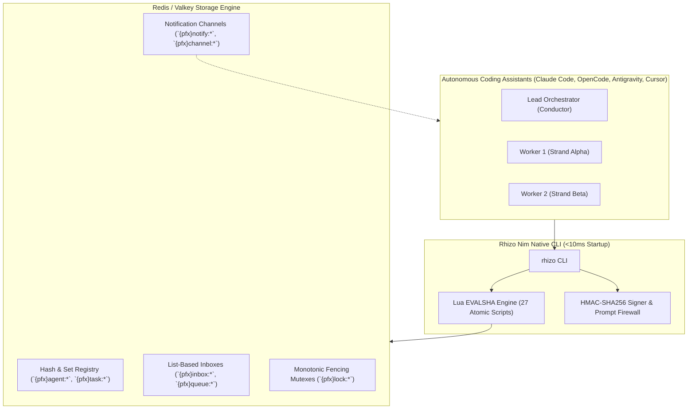

# Rhizo System Architecture & Redis Internal Engine

> **High-Performance Coordination Architecture**  
> *A technical reference for engineers and autonomous agents on the Redis keyspace, atomic Lua scripting engine, connection pooling, and fail-safe crash handling.*

---

## 1. High-Level Architecture Overview

Rhizo is a lightweight, zero-daemon inter-agent coordination bus implemented in native Nim with sub-millisecond execution times. Instead of relying on monolithic background servers or brittle Unix domain sockets, Rhizo coordinates multi-agent fleets entirely over Redis (or Valkey) using atomic Lua scripts and pub/sub notifications.

---

## 2. Redis Keyspace Architecture

All Rhizo Redis keys are scoped by a configurable namespace prefix (`rhizo:` by default, customized via `RHIZO_PREFIX` or `.rhizo.toml`). In Redis Cluster environments, key names utilize Redis Hash Tags (e.g. `{rhizo}:agent:<name>`) ensuring that all related keys hash to the same cluster slot for atomic multi-key Lua execution.

### Key Hierarchy & Schema

| Keyspace Pattern | Redis Type | TTL / Eviction | Description |
| :--- | :--- | :--- | :--- |
| `{pfx}agent:<name>` | Hash | 300s (Refreshed by heartbeat) | Registered agent metadata (`name`, `project`, `tags`, `harness`, `status`, `registered_at`, `last_seen`, `current_task`). |
| `{pfx}agents` | Set | Persistent | Active agent registry containing all known agent codenames. |
| `{pfx}inbox:<name>` | List | Persistent | FIFO queue of incoming messages for a specific agent. Popped atomically via `BLPOP`/`BRPOP` or Lua drain. |
| `{pfx}queue:<name>` | List | Persistent | Competing-consumer work queue. Workers pop tasks with atomic lease reservation. |
| `{pfx}task:<id>` | Hash | Persistent | Work Item State Machine (WISM) record: state, payload, lease owner, fence token, timestamps, attempts. |
| `{pfx}lock:<resource>` | Hash | Configurable lease (default 300s) | Distributed mutex lock. Stores `holder`, `token` (monotonic 64-bit int), `lease_until`, and `fencing_counter`. |
| `{pfx}fencing:<resource>` | String (Int) | Persistent | Monotonically increasing 64-bit fencing counter incremented on every lock acquisition. |
| `{pfx}channel:<name>` | Channel (Pub/Sub) | N/A (Ephemeral) | High-speed multicast/broadcast pub/sub channel for swarm-wide announcements. |
| `{pfx}notify:<name>` | Channel (Pub/Sub) | N/A (Ephemeral) | Dedicated agent notification ping alerting blocked listeners of new inbox mail. |
| `{pfx}alias:<alias>` | String | Persistent | Causal bidirectional alias pointing an abstract role (e.g. `lead`) to an active codename (`rhizo-sequoia`). |
| `{pfx}floor:<session>` | Hash | Auto-expiring lease | Roundtable floor control state: `current_speaker`, `speaker_until`, `queue`. |
| `{pfx}ballot:<id>` | Hash | Configurable expiry | Blind consensus ballot: `topic`, `options`, `votes_hash`, `revealed`. |
| `{pfx}leader:<group>` | Hash | Auto-expiring lease | Mesh leader election: `leader`, `term`, `lease_until`. |

---

## 3. Lua Scripting Engine & Atomic Operations

To prevent race conditions, dirty reads, and split-brain states across parallel assistants, Rhizo executes all state transitions inside **atomic Redis Lua scripts**.

### EVALSHA Performance Cache
Upon initialization, Rhizo compiles and caches the SHA-1 digest of each Lua script:
1. `EVALSHA <digest> ...`: Executes cached byte-code in <0.2ms.
2. If `NOSCRIPT` error is returned, Rhizo falls back to `SCRIPT LOAD` and retries `EVALSHA` automatically.

### Key Atomic Scripts

| Script Name | File Path | Invariant Enforced |
| :--- | :--- | :--- |
| `send_o2o.lua` | `scripts/send_o2o.lua` | Atomically pushes message to recipient inbox, verifies recipient existence, resolves aliases, updates unread counters, and emits pub/sub wake notification. |
| `drain.lua` | `scripts/drain.lua` | Atomically pops up to $N$ messages from an inbox, clears unread counters, and returns JSON array. |
| `lock_acquire.lua` | `scripts/lock_acquire.lua` | Evaluates lease expiration, increments monotonic fencing token (`INCR`), and claims ownership atomically. |
| `lock_release.lua` | `scripts/lock_release.lua` | Validates that caller still holds the active lease and matching fencing token before releasing lock. |
| `task_create.lua` | `scripts/task_create.lua` | Initializes WISM task hash, checks DAG `depends_on` parents, sets state to `QUEUED` (if zero unmet dependencies) or `BLOCKED`. |
| `task_claim.lua` | `scripts/task_claim.lua` | Pops task from queue, transitions state to `CLAIMED`, stamps worker lease and monotonic fence token, increments attempt counter. |
| `task_complete.lua` | `scripts/task_complete.lua` | Validates lease owner, transitions state to `COMPLETED`, removes from active list, and auto-promotes downstream dependent child tasks from `BLOCKED` to `QUEUED`. |
| `task_orphan.lua` | `scripts/task_orphan.lua` | Sweeps expired leases; transitions tasks to `ORPHANED` (and re-queues if `attempts < max_attempts`) or moves to `DEAD_LETTER`. |
| `reroute.lua` | `scripts/reroute.lua` | Atomically shifts pending task payloads between agent inboxes during failover or alias changes. |
| `who.lua` | `scripts/who.lua` | Aggregates all registered agents, checks heartbeat timestamps against current Redis server time, and categorizes status (`ACTIVE`, `BUSY`, `STALE`, `DEAD`). |

---

## 4. Connection Pooling & Transport Resiliency

Rhizo maintains connection discipline across diverse operating environments:

1. **Keepalive & TCP Probing**: TCP keepalive is enabled on all client connections (`TCP_NODELAY`, `SO_KEEPALIVE`) to survive NAT timeouts and cloud firewalls.
2. **Backoff Jitter Floor**: When waiting on Redis locks or polling retries, Rhizo uses randomized exponential backoff with a minimum jitter floor ($\pm 15\%$) to eliminate thundering herd synchronization across swarm workers.
3. **Unix Domain Sockets vs TCP**: Rhizo auto-detects `redis.sock` for zero-overhead local IPC, falling back to TCP loopback (`127.0.0.1:6379`).
4. **Air-Gap Prompt Firewall**: Inbound messages are cryptographically validated using HMAC-SHA256 signatures before entering LLM working memory. Messages with mismatched signatures or unauthenticated origins are routed to quarantine or rejected.

---

## 5. Performance Benchmarks

Measured on Apple Silicon (M3 Max / M2 Pro) over local Redis 7.2:

- **CLI Process Cold-Start**: $\le 9\text{ ms}$
- **`rhizo ping` Round-Trip**: $0.22\text{ ms}$
- **`rhizo send` (HMAC + Lua EVALSHA + PubSub)**: $0.48\text{ ms}$
- **`rhizo claim` (Competing-consumer lease reservation)**: $0.61\text{ ms}$
- **`rhizo lock --fencing` (Atomic lock + Monotonic Counter)**: $0.54\text{ ms}$
- **Throughput Capacity**: $> 14,000\text{ msgs/sec}$ per core
