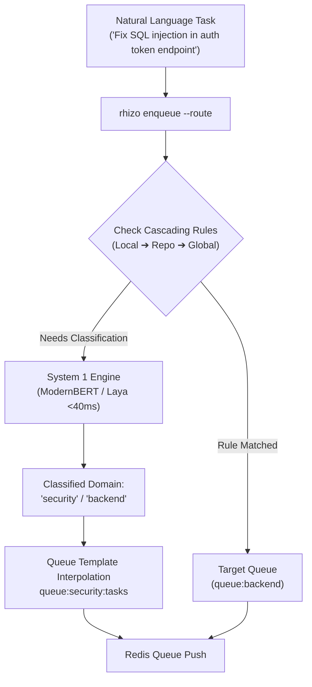

# Rhizo System 1 Semantic Task Routing Protocol

> **Sub-40ms Intent Classification, Semantic Triage & Cascading YAML Routing**  
> *A comprehensive specification for zero-shot natural language task routing using local ModernBERT models, the Laya decision engine, and cascading YAML rulebooks.*

---

## 1. Overview & System 1 Architecture

Rhizo incorporates an optional **System 1 Decision Engine** for high-throughput, non-autoregressive triage of natural language tasks. Instead of paying multi-second generative LLM token latencies to route tasks, Rhizo classifies intent in $<40\text{ ms}$ using local ModernBERT embedding heads or CoreML Execution Providers.



---

## 2. Cascading Configuration Hierarchy

Rhizo evaluates routing rules in a cascading hierarchy where more specific, repository-level configurations cleanly override broader machine-wide rules:

| Precedence | Configuration Path | Scope | Purpose |
| :---: | :--- | :--- | :--- |
| **1 (Highest)** | `rhizo-routes.local.yaml` | Developer Scratch | Uncommitted developer-local scratch overrides. |
| **2** | `packages/*/rhizo-routes.yaml` | Subproject | Monorepo subpackage specific routing. |
| **3** | `<repo-root>/rhizo-routes.yaml` | Repository | Canonical team-shared project routing rules. |
| **4** | `~/.config/rhizo/rhizo-routes.yaml` | Machine-Wide | Global user routing rules applying across all repositories. |
| **5 (Lowest)** | Built-in Baseline | Global Default | Fallback classifier routing to standard domain queues (`queue:swarm:{{ domain.choice }}`). |

### CLI Scaffolding & Verification
```bash
rhizo route init           # Scaffolds project rhizo-routes.yaml in current directory
rhizo route init --global  # Scaffolds machine-wide ~/.config/rhizo/rhizo-routes.yaml
rhizo route lint           # Validates YAML syntax against formal JSON schema
rhizo route lint --check-service  # Verifies local System 1 daemon connectivity
rhizo route test "Fix memory leak in ccache"  # Dry-run intent routing
```

---

## 3. Configuration YAML Schema Specification

A valid `rhizo-routes.yaml` file defines intent models, candidate domains, matching operators, and routing targets:

```yaml
version: "1.0"
description: "Arborus Triad Production Task Routing"

defaults:
  fallback_queue: "queue:triage"
  max_latency_ms: 100
  confidence_threshold: 0.65

# System 1 Classifier Models
models:
  domain_classifier:
    type: "choice"
    prompt: "Classify this software engineering task into the appropriate domain:"
    candidates:
      - "backend"
      - "frontend"
      - "devops"
      - "security"
      - "documentation"
      - "firmware"
    temperature: 0.0

# Deterministic Pre-Filtering Rules (Fast-Path)
rules:
  # Exact string or prefix matches bypass neural classifier entirely (<1ms)
  - name: "Security Vulnerabilities"
    match:
      operator: "regex"
      pattern: "(?i)(cve|vulnerability|exploit|rce|sql\\s*injection)"
    target: "queue:security:critical"
    priority: 100

  - name: "Documentation Fixes"
    match:
      operator: "regex"
      pattern: "(?i)(\\.md$|readme|typo|docs|documentation)"
    target: "queue:docs:tasks"
    priority: 90

  # Semantic classification rule via ModernBERT
  - name: "Standard Engineering Triage"
    match:
      operator: "semantic"
      model: "domain_classifier"
    target: "queue:swarm:{{ domain.choice }}"
    priority: 10
```

### Match Operators Reference

| Operator | Evaluator | Latency | Description |
| :--- | :--- | :--- | :--- |
| `exact` | String equality | $<0.1\text{ ms}$ | Target matches exact string pattern. |
| `prefix` | String prefix | $<0.1\text{ ms}$ | Target begins with prefix string. |
| `regex` | PCRE Regular Expression | $<0.5\text{ ms}$ | Case-insensitive regular expression pattern match. |
| `embedding` | Vector Cosine Similarity | $<15\text{ ms}$ | Matches task embedding against candidate cluster centroids. |
| `semantic` | ModernBERT / Laya Choice | $<35\text{ ms}$ | Zero-shot softmax classification over bounded candidates ($B \le 8$). |

---

## 4. Local System 1 Daemon Setup

For production deployments requiring fully local, zero-cloud execution:

### Installation via Python / Pip
```bash
pip install "git+https://github.com/axiomantic/local-systemone.git#egg=local-systemone[full]"
```

### Service Installation (macOS & Linux)
```bash
# Installs launchd service (macOS) or systemd service (Linux) on port 8100:
local-systemone --install-daemon

# Verify service status:
curl -s http://127.0.0.1:8100/health
# Output: {"status":"ok","model":"ModernBERT-base","engine":"CoreML","latency_ms":18.4}
```

### Cloud Alternative (TypeSafe Jev API)
To use cloud-hosted inference without running a local daemon:
```bash
export LAYA_API_URL="https://api.typesafe.ai"
export LAYA_API_KEY="your-api-key"
```
