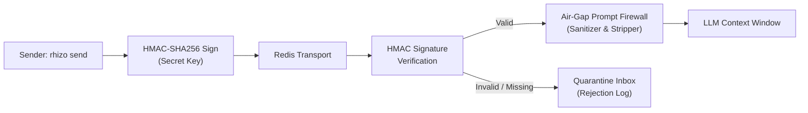

# Rhizo Inter-Agent Wire Protocol Specification

> **Formal Transport Specification & Envelope Schema**  
> *A normative specification for inter-assistant message exchange, cryptographic verification, prompt injection firewalls, and causal ordering.*

---

## 1. Protocol Overview

Rhizo uses a strongly-typed JSON message envelope transmitted over Redis lists (`inbox:<agent>`) and pub/sub notification channels. Every message is cryptographically signed using HMAC-SHA256 and subject to an Air-Gap Prompt Firewall to protect autonomous agents against malicious prompt injection and untrusted payload execution.

---

## 2. Wire Envelope Schema

All messages passed through `rhizo send`, `rhizo reply`, `rhizo broadcast`, or queued in `inbox:*` adhere strictly to the following JSON schema:

```json
{
  "$schema": "https://json-schema.org/draft/2020-12/schema",
  "title": "RhizoMessageEnvelope",
  "type": "object",
  "required": [
    "id",
    "type",
    "from",
    "to",
    "subject",
    "body",
    "timestamp",
    "seq",
    "signature"
  ],
  "properties": {
    "id": {
      "type": "string",
      "description": "Globally unique UUIDv4 identifying this transmission."
    },
    "type": {
      "type": "string",
      "enum": ["task", "reply", "broadcast", "rpc_request", "rpc_response", "heartbeat", "gate_report"],
      "description": "Semantic category governing routing, listener waking, and WISM state tracking."
    },
    "from": {
      "type": "string",
      "description": "Normalized codename of sending agent (case-insensitive)."
    },
    "to": {
      "type": "string",
      "description": "Target agent codename, work queue ('queue:<name>'), or broadcast multicast channel ('@<tag>')."
    },
    "subject": {
      "type": "string",
      "description": "Concise summary line. Checked by listener state machines for completion keywords."
    },
    "body": {
      "type": "string",
      "description": "Primary message payload. May contain markdown, JSON, code patches, or prompt text."
    },
    "reply_to": {
      "type": "string",
      "description": "Optional inbox address or queue to route direct replies to."
    },
    "correlation_id": {
      "type": "string",
      "description": "Task ID or parent conversation UUID linking distributed request-response flows."
    },
    "timestamp": {
      "type": "integer",
      "description": "Unix epoch timestamp in milliseconds at time of transmission."
    },
    "seq": {
      "type": "integer",
      "description": "Monotonically increasing causal sequence number emitted by the sender."
    },
    "signature": {
      "type": "string",
      "description": "HMAC-SHA256 hex digest certifying payload integrity and sender authenticity."
    },
    "headers": {
      "type": "object",
      "description": "Optional key-value metadata dictionary for transport extensions.",
      "additionalProperties": {
        "type": "string"
      }
    }
  },
  "additionalProperties": false
}
```

---

## 3. Cryptographic Verification & Prompt Firewall

Rhizo enforces a strict **Zero-Trust Message Integrity Policy**:



### Signature Computation
The HMAC-SHA256 signature is computed over the canonical string concatenation:
$$\text{Signature} = \text{HMAC-SHA256}\Big(K_{\text{secret}}, \, \texttt{"\{id\}:\{from\}:\{to\}:\{type\}:\{seq\}:\{timestamp\}:\{sha256(body)\}"}\Big)$$

1. **Shared Secret Resolution**:
   - Resolved from `RHIZO_SECRET_KEY` environment variable.
   - Falls back to `.rhizo.local.toml` $\to$ `.rhizo.toml` $\to$ machine-local cluster key (`~/.config/rhizo/cluster.key`).
2. **Replay & Tamper Detection**:
   - Messages older than 300 seconds are rejected unless explicitly configured.
   - Out-of-order sequence counters (`seq`) flag dropped packets or spoofing attempts.
3. **Air-Gap Prompt Firewall**:
   - Inbound message bodies are sanitized before presentation to LLM harnesses.
   - Escapes hidden system prompt injection deltas (`<system>`, `[INST]`, `### Human:` delimiters).
   - Enforces UTF-8 character normalization.

---

## 4. Message Types & Delivery Semantics

| Message Type | Semantics | Listener Action | WISM Transition Trigger |
| :--- | :--- | :--- | :--- |
| `task` | Directed assignment to worker. | Single-shot wake; displays prompt payload. | Transitions task from `QUEUED` to `DELIVERED`. |
| `reply` | Directed response to previous message. | Unblocks listener; returns payload to sender. | If subject contains completion keywords, triggers worker auto-idle. |
| `broadcast` | Multicast announcement to all agents. | Broadcast to `channel:all` or `channel:<tag>`. | Informational; does NOT set worker to `BUSY`. |
| `rpc_request` | Synchronous query awaiting response. | Wakes worker; expects matching `correlation_id` reply. | Holds RPC timeout lease. |
| `rpc_response`| Response payload answering `rpc_request`. | Delivers response to waiting RPC caller. | Resolves RPC caller promise. |
| `gate_report` | Two-Key Gate verification outcome. | Delivered to Lead Orchestrator. | Triggers WISM transition to `READY_TO_WEAVE` or `GATE_FAILED`. |

---

## 5. Case-Insensitive Addressing & Routing Rules

All agent codenames, inbox addresses, and multicast tags are **case-insensitive**:
- A message sent to `Worker-Alpha`, `worker-alpha`, or `WORKER-ALPHA` resolves to the identical Redis queue (`rhizo:inbox:worker-alpha`).
- Multicast tags (e.g. `@Architect`, `@architect`) resolve to `rhizo:channel:architect`.
- Work queues (e.g. `queue:Backend:Tasks`) normalize to `rhizo:queue:backend:tasks`.

---

## 6. Delivery Guarantees & Single-Shot Discipline

1. **At-Least-Once Delivery**: Messages are pushed to persistent Redis lists via atomic Lua scripts. They remain stored until explicitly popped or drained.
2. **Single-Shot Listener Invariant**: `rhizo listen <agent>` executes a blocking pop (`BLPOP` or `BRPOP`) with zero timeout (infinite wait). Upon message arrival, it outputs the envelope and **immediately terminates**. Re-arming is handled by the orchestrator in a subsequent turn.
3. **Transport Receipts**: When a worker listener pops a `task` envelope, Rhizo emits an atomic transport receipt (`rhizo:receipt:<task_id>`) notifying the orchestrator that the worker has received the payload.
