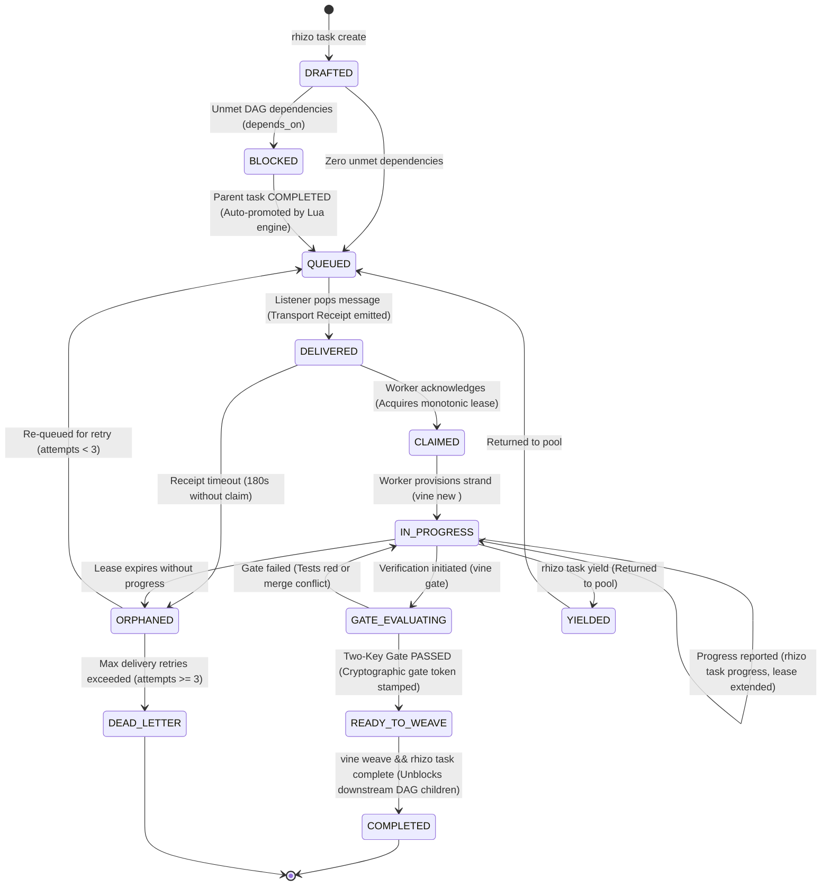

# Unified Work Item State Machine (WISM) Specification

> **Formal State Machine, Distributed Leases & DAG Orchestration**  
> *A normative specification governing task lifecycles, atomic Lua state transitions, monotonic fencing leases, and Two-Key integration across Rhizo, Garden, and Vine.*

---

## 1. Overview & Architectural Role

The **Work Item State Machine (WISM)** is the formal lifecycle engine governing all tasks executed across multi-agent swarms. Every work item progresses through deterministic, verifiable states backed by atomic Redis Lua operations.



---

## 2. ASCII State Transition Reference (LLM Fast-Path)

```text
  [rhizo task create]
          │
          ▼
     +---------+      Unmet deps
     | DRAFTED | ──────────────────► [ BLOCKED ]
     +---------+                         │
          │ Zero deps                    │ Parent task COMPLETED
          ▼                              ▼
     +---------+ ◄───────────────────────+
     | QUEUED  |
     +---------+
          │
          │ rhizo listen pops task (Transport Receipt emitted)
          ▼
    +-----------+      180s Receipt Timeout
    | DELIVERED | ─────────────────────────────────► [ ORPHANED ]
    +-----------+                                          │
          │                                                │ Attempts >= 3
          │ rhizo task claim / rhizo reply                 ▼
          ▼                                         [ DEAD_LETTER ]
     +---------+
     | CLAIMED |
     +---------+
          │
          │ vine new <task_id> (Provision strand)
          ▼
   +-------------+      Lease expires
   | IN_PROGRESS | ────────────────────────────────► [ ORPHANED ]
   +-------------+
     │        ▲
     │ vine   │ Gate fails
     │ gate   │ (Tests red or conflict)
     ▼        │
  +-----------------+
  | GATE_EVALUATING |
  +-----------------+
          │
          │ Two-Key Gate PASSED (Key 1 merge-tree + Key 2 live test suite green)
          ▼
  +----------------+
  | READY_TO_WEAVE |
  +----------------+
          │
          │ vine weave && rhizo task complete
          ▼
    +-----------+
    | COMPLETED | ──► Auto-promotes BLOCKED child tasks to QUEUED!
    +-----------+
```

---

## 3. Formal State Definitions & Invariants

| State | CLI Trigger | Atomic Action & Side Effects | Timeout / Failure Escalation |
| :--- | :--- | :--- | :--- |
| **`DRAFTED`** | `rhizo task create <id>` | Task record initialized in Redis hash `{pfx}task:<id>`. Evaluates `depends_on` list. | None. Transitions immediately to `QUEUED` or `BLOCKED`. |
| **`BLOCKED`** | Automatic | Held in `{pfx}tasks:blocked`. Waits for parent task completion. | If parent enters `DEAD_LETTER`, child transitions to `DEAD_LETTER`. |
| **`QUEUED`** | Automatic or `rhizo enqueue` | Task ID pushed to work queue (`{pfx}queue:<name>`). Ready for worker acquisition. | None. Remains until worker claims. |
| **`DELIVERED`** | `rhizo listen` pop | Worker popped task envelope from queue. Emits atomic transport receipt `{pfx}receipt:<id>`. | **180s Receipt Timeout**: If worker fails to claim within 180s, task transitions to `ORPHANED`. |
| **`CLAIMED`** | `rhizo task claim <id>` | Worker acquires task ownership, increments attempts, and obtains monotonic fencing lease. | Configurable lease timeout (default 1800s). |
| **`IN_PROGRESS`** | `vine new <id>` | Worker enters isolated strand and executes implementation. `rhizo task progress` extends lease. | Lease expiration without progress transitions to `ORPHANED`. |
| **`GATE_EVALUATING`** | `vine gate` | Worker executes Two-Key Gate (Key 1 merge-tree conflict check + Key 2 project test suite). | Test failure returns task to `IN_PROGRESS` with error diagnostics. |
| **`READY_TO_WEAVE`** | `vine gate` exit 0 | Two-Key Gate passes 100% green. Cryptographic `gate_token` stamped into task record. | Ready for Lead Orchestrator trunk integration. |
| **`COMPLETED`** | `rhizo task complete <id>` | Task finalized. Atomically unblocks downstream dependent child tasks, auto-promoting them to `QUEUED`. | Terminal state. |
| **`ORPHANED`** | Watchdog sweep | Task lease expired without progress or claim timed out. Increments attempt counter. | If `attempts < 3`: auto-requeued to `QUEUED`. If `attempts >= 3`: moved to `DEAD_LETTER`. |
| **`YIELDED`** | `rhizo task yield <id>` | Worker cooperatively relinquishes task due to blockers or resource conflicts. | Returned to `QUEUED` with zero penalty to retry counter. |
| **`DEAD_LETTER`** | Watchdog escalation | Poison pill or permanently failed task exceeding maximum retries ($N \ge 3$). | Terminal state. Alerts human operator or Lead Orchestrator. |

---

## 4. Monotonic Fencing Leases & Zombie Write Prevention

Distributed workers operating over networks or long-running subshells risk executing after their lease has expired, potentially corrupting shared state. Rhizo prevents this via **Monotonic Fencing Tokens**:

1. **Atomic Fencing Counter**:
   Every resource lock or task lease increments a Redis 64-bit integer (`{pfx}fencing:<resource>`).
2. **Lease Validation**:
   When a worker acquires a task, it receives `fencing_token = N`.
3. **Fencing Verification**:
   All state updates (`rhizo task progress`, `rhizo task complete`) submit `fencing_token`. If another worker has preempted the lease (`token > N`), the update is rejected atomically by Lua (`ERR_STALE_FENCE_TOKEN`).

---

## 5. Automated DAG Dependency Resolution

Rhizo supports complex Directed Acyclic Graph (DAG) task pipelines:

```bash
# Create DAG pipeline:
rhizo task create task-db-schema --queue queue:backend
rhizo task create task-api-routes --depends-on task-db-schema --queue queue:backend
rhizo task create task-frontend --depends-on task-api-routes --queue queue:frontend
```

1. **Dependency Analysis**: `task_create.lua` inspects `{pfx}task:<dep>:state` for each parent.
2. **Blocked Placement**: If any parent is not `COMPLETED`, child is stamped `BLOCKED` and placed in `{pfx}tasks:blocked:<parent_id>`.
3. **Cascading Unblocking**: When `rhizo task complete task-db-schema` is called, `task_complete.lua` inspects the set of children. For each child with zero remaining unmet dependencies, it transitions the child to `QUEUED` and pushes it to its assigned work queue.
